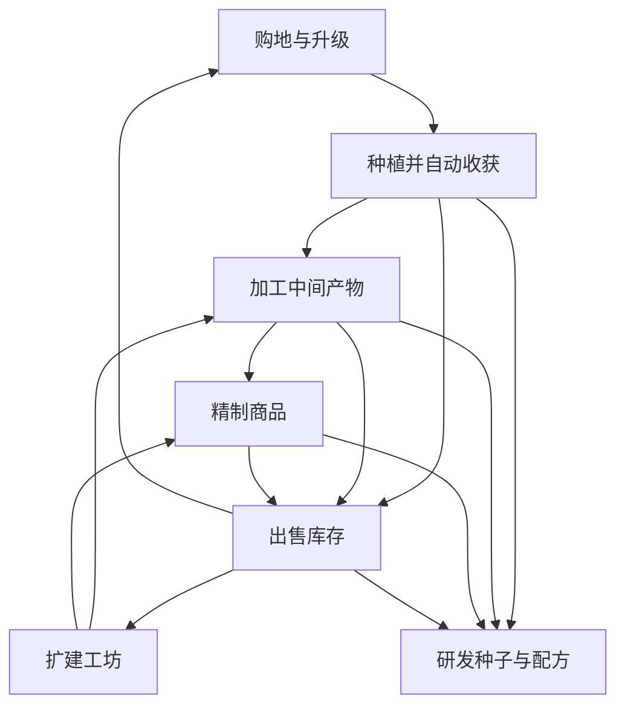

# 《放置农场》游戏设计式样书

当前经济正式式样见[扩展入口](expansion/README.md)、[LT-v2经营规则](expansion/01-operations.md)与[价格生成规则](expansion/07-balance-validation.md)。本页保留1.13基础规格与历史算例；后续局部修订不使旧价格、300项总量、科技五档费用、旧RP/品质公式及2→12h离线恢复为现行规则。LT-2026-11-v2对这些数值明确优先，实际主入口接入与经营效果仍未运行验收。

LT-v2保留523研发原coins/costs/requires、一次付清，保留高级科技50级及原品项前置、品质独立/整金币/同ID同价、任意产值原sellFarm领取RP并按原流程重建。科技改为C_B价、离线8/24/36h、内部跨轮活动T/权益余额但仅出售发点，任务只改金额不改条件。旧未花RP只×25一次、旧本轮奖励冻结×25只在下次出售领取，详见经营规则。

| 项目 | 规格 |
| --- | --- |
| 版本 | 1.13 · 首发开发基线 |
| 类型 | 单人、竖屏、种植与生产线管理 |
| 目标平台 | Android Chrome、iOS Safari，移动 Web，首次完整加载后可离线游玩，浏览器本机单存档 |
| 技术栈 | HTML5 + JavaScript ES Modules + PixiJS 8，单画布，全程竖屏 |
| 主题与表现 | 日式动漫像素牧场，明亮、温暖的乡村工坊 |
| 首发内容 | 50 种作物、100 种中间产物、150 种商品、298 个种子与配方研发节点、300 条品种与品质成长线、8 条永久效率科技线 |
| 完成目标 | 制作南岛珍果千层，完成一次牧场出售并体验永久改良。全图鉴为独立收集目标，达成后可继续经营 |

[历史数值平衡](balance.md)只供1.13溯源；当前数值调整与未验收限制见[LT-v2定案](reviews/2026-11-15-long-term-balance-report.md)。

## 目录

1. [产品定位与首发范围](#01)
2. [玩法循环与进度](#02)
3. [土地、工坊与自动生产](#03)
4. [物品与完整配方表](#04) · [50 种作物](#catalog-c) · [100 种中间产物](#catalog-i) · [150 种商品](#catalog-p)
5. [研发与品质](#05) · [种子研发](#research-c) · [中间产物配方研发](#research-i) · [商品配方研发](#research-p)
6. [永久效率科技与周回](#06)
7. [交易、数值与离线进度](#07)
8. [移动端界面与交互](#08)
9. [美术、音频与本地化](#09)
10. [数据结构、存档与开发顺序](#10)
11. [验收用例与调优口径](#11)

<a id="01"></a>
## 1. 产品定位与首发范围

玩家经营一座乡间牧场，用种植收入购地、升级地块，并购置加工和精制工位。经营决策集中在原料直售、留作研发、继续加工三种用途，以及如何调整田地和工位，使下游持续有料。面粉、糖浆等早期物品在后续配方中继续作为原料，玩家可根据瓶颈扩建早期产能。

首发交付包含完整图鉴、种子与配方研发、品质成长、可重复周回、离线进度、正式美术与音效、新手引导、设置和存档恢复。畜牧、角色社交、季节限制、移动探索、多人、账号与付费系统均在首发范围之外。所有研发条件列在第 5 节。图鉴和研发列表按物品类别浏览。

<a id="02"></a>
## 2. 玩法循环与进度



研发同时消耗金币和实物。每项种子和配方按自身的研究条件独立解锁，满足前置与成本即可研发。玩家可同时推进不同生产链，也可在满足牧场出售条件时开始新一轮。种子、配方和品质进度跨周回累积。

| 功能或目标 | 触发条件 |
| --- | --- |
| 出售牧场 | 随时可出售。生产总值达到 1,000 后可获得高级研发点 |
| 高级研发点结算 | 本周目生产总值经「经营评估」倍率结算，具体点数见第 6 节 |
| 本轮经营目标 | 实际制作南岛珍果千层 |
| 图鉴完成 | 累计研发全部品项，首次建档已开放的小麦和面粉计入 |

工坊通过增设工位并行生产，通过「工坊提速」缩短每批耗时。

**首次建档。** 金币 60，空库存，2 块一级空田，1 个空闲加工位、1 个空闲精制位，解锁小麦和面粉，所有品质为 1，高级研发点和效率等级为 0。初始田地没有已选作物或活动批次，玩家先点击「播种」选择小麦，随后才开始计时和自动续作。新建和清档重开均不自动播种；已有存档作物及周回的既有开局规则保留。免费田地与免费播种使玩家仍可从金币 0、库存 0 恢复经营。

<a id="03"></a>
## 3. 土地、工坊与自动生产

### 3.1 设施购买与升级

设施购买条件为金币和对应类型的容量。设施上限是同时作业的容量。作物和配方多于工位时，通过换种、换配方和库存保留轮作备货。每个设施有稳定的数字购买序号。新购设施为空闲，支持立即选择作物或配方。设施不可单独出售。价格使用任意精度整数运算，`ceilDiv` 定义见第 7 节。

| 操作 | 基准价格 | 首发上限 |
| --- | --- | --- |
| 购地 | `ceilDiv(60 × 6^(n−2), 5^(n−2))`，`n` 为购买前田地总数 | 40 块 |
| 增设加工位 | `ceilDiv(75 × 6^(n−1), 5^(n−1))`，`n` 为购买前加工位总数 | 48 个 |
| 增设精制位 | `ceilDiv(95 × 6^(n−1), 5^(n−1))`，`n` 为购买前精制位总数 | 32 个 |
| 升级地块 | 按当前等级至目标等级之间的累计投入差额计价 | 等级持续增长 |

两块初始田和两个初始工位计入公式中的设施总数。购地、地块升级分别适用各自的永久折扣。工位购买使用基准价格，出售牧场后工位重置为加工、精制各1个，下一轮从初始数量重新计算购买价格。连续购买按每次成功扣费前的设施数重新报价。

地块等级从 1 起。升级可选 +1、+10、+100 或升到可负担等级。设 `k = 等级 − 1`，`d` 为当前地块升级折扣基点。累计价及报价如下。

```text
S2(k) = k × (k+1) × (2k+1) // 6
累计原价(k) = 30 × S2(k) + 5000 × max(0, k−14)^5
累计折后价(k) = ceilDiv(累计原价(k) × (10000−d), 10000)
本次金币 = 累计折后价(目标等级−1) − 累计折后价(当前等级−1)
```

折扣相同时，批量升级与逐级升级的总价一致。「升到可负担等级」先倍增上界再二分查找，以一次交易提交。金币或折扣变化时刷新报价。等级、成本和产出使用任意精度整数。对旧存档的等级和活动批次保留原值，新批次应用新收成规则。

### 3.2 地块

- 种子研发授予当轮种植权。播种与复种免费，种子以解锁状态记录。每块田同一时刻生长一种作物，到期自动入库并自动复种。
- 每批收成 `作物基础收成 + k + k^2 // 64 + 丰收栽培等级`，`k = 地块等级 − 1`。丰收栽培 0 级时，小麦田 6／15／101／1,001 级每批分别产出 7／19／258／16,627 份。作物周期见配方表，永久工坊提速仅作用于加工与精制。
- 换种立即取消未成熟的旧批次并开始新作物的生长。换养同样立即开始新周期。田地、畜牧、鱼池升级成功后立即更新当前未完成批次的产量，保留原起止时刻和成长进度；升级不提前收成或增加经营统计。空地播种即时开批。

### 3.3 工坊与共享库存

| 设施 | 可用配方 | 运行规则 |
| --- | --- | --- |
| 加工位 | 中间产物 | 每批消耗表中指定作物与先行中间产物 |
| 精制位 | 商品 | 每批只消耗表中指定的中间产物 |

- 每个工位同时运行一批，投入由配方规定，完工固定产出 1 件。材料不足时等待满足本批的全部投入。完工后立即检查下一批所需材料。
- 开批时一次性扣足全部原料，同时锁定输出品项、数量、完工时间。材料不足时保持库存原值。完工直接入库，下一批按届时配方与科技确定投入和耗时。工位产出区分别显示当前产物库存及活动批次锁定的产量，待开批时显示计划每批产出。更换配方立即中止未完成旧批次，退回已记录的投入，并重新检查新配方。材料齐备马上开工，材料不足保留新配方并等待。旧存档中缺少投入快照的批次以实际记录为准。
- 每项物品可设置「加工保留量」，默认 0，设置可高于当前库存。自动开批后每种输入的库存必须仍达到保留量。研发和手动出售可动用保留量，出售前提示并展示出售后的余额。玩家可调整保留量，留出研究材料。
- 工位自动争料时，先按玩家设置的优先级「优先／普通」，再按全工坊数字购买序号从早到晚。默认普通。某条线缺料时继续尝试其他工位。工坊允许同名配方在多条线上同时运行。
- 状态由当前批次和已选配方计算。存在活动批次时显示「生产中」。旧档的待执行安排显示于下一批提示中。无批次时显示「等待安排」或「等待材料」。材料齐备时自动开工。

### 3.4 模拟时序

逻辑时间使用整数毫秒。每个时点先把同刻完成的全部地块与工位产出汇总入库，随后处理该时点已接收的玩家指令，最后按序自动复种和派工。玩家指令按接收序号执行并逐条原子校验。指令抵达已经提交的时点时，视为该时点随后的一次指令事务，已开批的原料照常占用。离线无玩家指令，沿用同一完工和派工规则。截止时点上的完工也结算。

向前推进时只处理完工时点和玩家动作。开批时按下一完工时间入最小堆，空队列直接推进至目标时点。仅在原料入库、设施可用、设置改变或其他有效指令时尝试派工。无库存事件且所有工位在等待时，无需空转重试。离线运行时可以分段计算，完整结果提交后再开放交互。渲染刷新只更新表现，库存以提交后的模拟状态为准。

<a id="04"></a>
## 4. 物品与完整配方表

所有条目可按单件售价出售。表中时长单位为秒，程序加载时乘以 `1000`。`2×C01` 表示消耗 2 个小麦。生产输出唯一，作物在田地生长，其余品项只从对应配方产出。中间产物只使用作物及编号更小的中间产物，商品只使用中间产物。中间产物和商品每批固定产出 1 件。各类别的基础时长按品项编号严格递增，作物最长 300 秒，中间产物最长 600 秒，商品最长 1,800 秒。程序按工位已选配方的 ID 扣除投入并安排产出。水和盐等烹饪辅料若未列在表中，只属于工艺设定。

<a id="catalog-c"></a>
### 4.1 作物

| ID | 名称 | 基础生长秒数 | 每批基础收成 | 基准单价 |
| --- | --- | ---: | ---: | ---: |
| C01 | 小麦 | 12 | 2 | 3 |
| C02 | 甘蔗 | 16 | 2 | 5 |
| C03 | 草莓 | 20 | 2 | 8 |
| C04 | 玉米 | 25 | 2 | 13 |
| C05 | 苹果 | 29 | 2 | 18 |
| C06 | 蓝莓 | 34 | 2 | 24 |
| C07 | 茶叶 | 38 | 2 | 33 |
| C08 | 桂花 | 43 | 2 | 44 |
| C09 | 可可豆 | 47 | 2 | 57 |
| C10 | 香草荚 | 52 | 2 | 76 |
| C11 | 樱桃 | 57 | 2 | 100 |
| C12 | 栗子 | 61 | 2 | 132 |
| C13 | 糯稻 | 66 | 3 | 150 |
| C14 | 粳稻 | 70 | 4 | 165 |
| C15 | 大麦 | 75 | 4 | 182 |
| C16 | 荞麦 | 79 | 3 | 202 |
| C17 | 小米 | 84 | 4 | 227 |
| C18 | 黄豆 | 88 | 3 | 254 |
| C19 | 红小豆 | 93 | 3 | 278 |
| C20 | 红薯 | 97 | 4 | 302 |
| C21 | 芋头 | 102 | 3 | 325 |
| C22 | 莲藕 | 106 | 3 | 353 |
| C23 | 砂梨 | 111 | 3 | 389 |
| C24 | 白桃 | 115 | 3 | 432 |
| C25 | 蜜柑 | 120 | 3 | 473 |
| C26 | 甜柿 | 126 | 3 | 513 |
| C27 | 青梅 | 132 | 3 | 556 |
| C28 | 金柑 | 138 | 4 | 603 |
| C29 | 无花果 | 144 | 3 | 664 |
| C30 | 黄金香柚 | 150 | 4 | 723 |
| C31 | 琥珀枇杷 | 156 | 3 | 785 |
| C32 | 蜜香花梨 | 162 | 4 | 849 |
| C33 | 茄子 | 168 | 4 | 888 |
| C34 | 番茄 | 174 | 4 | 963 |
| C35 | 青椒 | 180 | 4 | 1040 |
| C36 | 南瓜 | 186 | 5 | 1118 |
| C37 | 卷心菜 | 192 | 5 | 1199 |
| C38 | 大葱 | 198 | 4 | 1307 |
| C39 | 紫苏 | 204 | 4 | 1418 |
| C40 | 翡翠山椒 | 210 | 4 | 1558 |
| C41 | 雪香白芝麻 | 219 | 5 | 1702 |
| C42 | 金冠菠萝 | 228 | 4 | 1756 |
| C43 | 蜜香蕉 | 237 | 4 | 1878 |
| C44 | 翡翠青柠 | 246 | 4 | 2004 |
| C45 | 雪瓤椰子 | 255 | 4 | 2147 |
| C46 | 金煌芒果 | 264 | 5 | 2307 |
| C47 | 紫玉百香果 | 273 | 5 | 2456 |
| C48 | 胭脂火龙果 | 282 | 5 | 2624 |
| C49 | 金壳夏威夷果 | 291 | 5 | 2795 |
| C50 | 翡翠斑斓叶 | 300 | 6 | 2985 |

<a id="catalog-i"></a>
### 4.2 中间产物

| ID | 名称 | 每批输入 | 每批基础产出 | 基础加工秒数 | 基准单价 |
| --- | --- | --- | ---: | ---: | ---: |
| I01 | 面粉 | 2×C01 | 1 | 9 | 10 |
| I02 | 糖浆 | 2×C02 | 1 | 11 | 17 |
| I03 | 草莓果酱 | 2×C03 + 1×I02 | 1 | 15 | 50 |
| I04 | 玉米粉 | 2×C04 | 1 | 18 | 44 |
| I05 | 苹果泥 | 2×C05 + 1×I02 | 1 | 20 | 78 |
| I06 | 蓝莓果酱 | 2×C06 + 1×I02 | 1 | 23 | 96 |
| I07 | 茶粉 | 2×C07 | 1 | 25 | 93 |
| I08 | 桂花糖 | 2×C08 + 1×I02 | 1 | 28 | 149 |
| I09 | 可可酱 | 2×C09 + 1×I02 | 1 | 30 | 186 |
| I10 | 香草糖 | 2×C10 + 1×I02 | 1 | 33 | 235 |
| I11 | 樱桃馅 | 2×C11 + 1×I02 | 1 | 36 | 298 |
| I12 | 栗子泥 | 2×C12 + 1×I02 | 1 | 39 | 386 |
| I13 | 糯米粉 | 2×C13 | 1 | 42 | 400 |
| I14 | 白米粒 | 2×C14 | 1 | 46 | 441 |
| I15 | 焙炒麦粒 | 2×C15 | 1 | 49 | 487 |
| I16 | 荞麦粉 | 2×C16 | 1 | 52 | 542 |
| I17 | 小米粉 | 2×C17 | 1 | 55 | 610 |
| I18 | 鲜豆浆 | 2×C18 | 1 | 58 | 684 |
| I19 | 红豆沙 | 2×C19 + 1×I02 | 1 | 61 | 774 |
| I20 | 红薯泥 | 2×C20 | 1 | 64 | 817 |
| I21 | 芋泥 | 2×C21 | 1 | 67 | 882 |
| I22 | 莲藕粉 | 2×C22 | 1 | 71 | 960 |
| I23 | 蒸糯米 | 3×C13 | 1 | 74 | 670 |
| I24 | 焙香米粒 | 3×C14 | 1 | 77 | 723 |
| I25 | 大麦浆 | 2×C15 + 1×I15 | 1 | 80 | 1309 |
| I26 | 荞麦面团 | 2×C16 + 1×I01 | 1 | 84 | 598 |
| I27 | 小米糖脆 | 2×C17 + 1×I02 | 1 | 88 | 676 |
| I28 | 熟黄豆粉 | 3×C18 | 1 | 92 | 1058 |
| I29 | 豆乳凝块 | 1×C18 + 2×I18 | 1 | 96 | 2501 |
| I30 | 蜜煮红豆 | 3×C19 + 2×I02 | 1 | 100 | 1237 |
| I31 | 蜜渍红薯丁 | 3×C20 + 1×I02 | 1 | 104 | 1283 |
| I32 | 芋香米糊 | 2×C21 + 1×C14 + 1×I14 | 1 | 108 | 1746 |
| I33 | 蜜釉藕片 | 2×C22 + 1×I22 + 1×I02 | 1 | 112 | 2693 |
| I34 | 五谷熟米团 | 1×I14 + 1×I23 + 1×I17 | 1 | 116 | 2754 |
| I35 | 砂梨蓉 | 2×C23 | 1 | 120 | 1089 |
| I36 | 蜜渍梨丁 | 2×C23 + 1×I02 | 1 | 124 | 1115 |
| I37 | 白桃泥 | 2×C24 | 1 | 128 | 1215 |
| I38 | 白桃浓露 | 1×I37 + 1×I02 | 1 | 132 | 1972 |
| I39 | 蜜柑果粒 | 2×C25 | 1 | 136 | 1336 |
| I40 | 蜜柑晶冻底 | 2×I39 + 1×I13 | 1 | 140 | 4916 |
| I41 | 软柿泥 | 2×C26 | 1 | 144 | 1455 |
| I42 | 柿干 | 3×C26 | 1 | 148 | 2187 |
| I43 | 青梅浓浆 | 2×C27 | 1 | 152 | 1584 |
| I44 | 糖渍青梅 | 2×C27 + 1×I02 | 1 | 156 | 1611 |
| I45 | 金柑蜜露果 | 2×C28 + 1×I02 + 1×I43 | 1 | 160 | 4492 |
| I46 | 金柑皮丝 | 3×C28 | 1 | 164 | 2593 |
| I47 | 无花果馅 | 2×C29 + 1×I02 | 1 | 168 | 1932 |
| I48 | 无花果干 | 3×C29 | 1 | 172 | 2867 |
| I49 | 黄金香柚皮蓉 | 2×C30 + 1×I08 | 1 | 176 | 2552 |
| I50 | 黄金香柚晶冻底 | 1×I49 + 1×I40 | 1 | 180 | 11949 |
| I51 | 枇杷果浆 | 2×C31 | 1 | 187 | 2275 |
| I52 | 琥珀糖渍枇杷 | 1×I51 + 2×C31 + 1×I02 | 1 | 194 | 6180 |
| I53 | 花梨果酱 | 2×C32 + 1×I02 | 1 | 202 | 2495 |
| I54 | 花梨金露 | 1×I53 + 1×I08 | 1 | 209 | 4231 |
| I55 | 香柚青梅蜜馅 | 1×I49 + 1×I44 | 1 | 216 | 6661 |
| I56 | 花梨枇杷双果冻底 | 1×I54 + 1×I51 + 1×I50 | 1 | 223 | 29528 |
| I57 | 炙烤茄片 | 2×C33 | 1 | 230 | 2606 |
| I58 | 炙茄细泥 | 2×I57 + 1×I02 | 1 | 238 | 8367 |
| I59 | 番茄酱 | 2×C34 | 1 | 245 | 2838 |
| I60 | 慢焙番茄干 | 2×C34 + 1×I59 | 1 | 252 | 7623 |
| I61 | 炙烤青椒 | 2×C35 | 1 | 259 | 3078 |
| I62 | 青椒丝 | 3×C35 | 1 | 266 | 4626 |
| I63 | 蒸磨南瓜蓉 | 2×C36 + 1×I13 | 1 | 274 | 4218 |
| I64 | 南瓜粉 | 3×C36 | 1 | 281 | 4993 |
| I65 | 卷心菜丝 | 2×C37 | 1 | 288 | 3578 |
| I66 | 紫苏风味腌卷心菜 | 2×I65 + 1×C39 | 1 | 295 | 13719 |
| I67 | 烤葱段 | 2×C38 | 1 | 302 | 3916 |
| I68 | 炙葱细泥 | 2×I67 + 1×I13 | 1 | 310 | 13172 |
| I69 | 紫苏碎 | 2×C39 | 1 | 317 | 4266 |
| I70 | 紫苏琥珀糖露 | 1×I69 + 1×I02 | 1 | 324 | 6853 |
| I71 | 山椒粉 | 2×C40 | 1 | 331 | 4707 |
| I72 | 山椒渍炙青椒 | 2×I61 + 1×I71 | 1 | 338 | 17381 |
| I73 | 白芝麻油 | 3×C41 | 1 | 346 | 7744 |
| I74 | 白芝麻酱 | 2×C41 | 1 | 353 | 5173 |
| I75 | 炙茄番茄浓酱 | 1×I58 + 1×I59 + 1×I60 | 1 | 360 | 30125 |
| I76 | 葱香芝麻金油 | 1×I67 + 1×I73 | 1 | 370 | 18656 |
| I77 | 紫苏双芝麻拌料 | 1×I69 + 1×I73 + 1×I74 | 1 | 379 | 27493 |
| I78 | 山椒南瓜细馅 | 1×I63 + 1×I64 + 1×I71 | 1 | 389 | 22269 |
| I79 | 菠萝汁 | 2×C42 | 1 | 398 | 5392 |
| I80 | 金冠蜜渍菠萝 | 2×C42 + 1×I79 + 1×I02 | 1 | 408 | 14274 |
| I81 | 香蕉泥 | 2×C43 | 1 | 418 | 5789 |
| I82 | 蜜蕉烤脆片 | 2×C43 + 1×I81 + 1×I02 | 1 | 427 | 15300 |
| I83 | 青柠汁 | 2×C44 | 1 | 437 | 6203 |
| I84 | 翡翠青柠皮丝 | 2×C44 + 1×I83 + 1×I02 | 1 | 446 | 16365 |
| I85 | 椰浆 | 2×C45 | 1 | 456 | 6672 |
| I86 | 雪香焙椰蓉 | 2×C45 + 1×I85 | 1 | 466 | 17546 |
| I87 | 芒果泥 | 2×C46 | 1 | 475 | 7197 |
| I88 | 金煌蜜芒果 | 2×C46 + 1×I87 + 1×I02 | 1 | 485 | 18925 |
| I89 | 百香果浆 | 2×C47 | 1 | 494 | 7693 |
| I90 | 紫玉百香果露 | 2×I89 + 1×I02 | 1 | 504 | 24645 |
| I91 | 火龙果汁 | 2×C48 | 1 | 514 | 8251 |
| I92 | 胭脂龙果晶冻坯 | 2×I91 + 1×I13 | 1 | 523 | 27044 |
| I93 | 烘烤夏威夷果 | 2×C49 | 1 | 533 | 8823 |
| I94 | 金壳果仁酱 | 2×I93 + 1×I73 | 1 | 542 | 40624 |
| I95 | 斑斓叶汁 | 2×C50 | 1 | 552 | 9460 |
| I96 | 翡翠斑斓糖露 | 2×I95 + 1×I02 | 1 | 562 | 30300 |
| I97 | 青柠菠萝蜜酱 | 1×I80 + 1×I84 + 1×I79 | 1 | 571 | 57650 |
| I98 | 雪瓤浓椰乳 | 2×I85 + 1×I86 | 1 | 581 | 49424 |
| I99 | 金煌芒果百香馅 | 1×I88 + 1×I90 + 1×I87 | 1 | 590 | 81228 |
| I100 | 翡翠斑斓椰乳馅 | 1×I96 + 1×I98 + 1×I86 | 1 | 600 | 155632 |

<a id="catalog-p"></a>
### 4.3 商品

| ID | 名称 | 每批输入 | 每批基础产出 | 基础精制秒数 | 基准单价 |
| --- | --- | --- | ---: | ---: | ---: |
| P01 | 乡村面包 | 2×I01 | 1 | 14 | 32 |
| P02 | 焦糖饼干 | 1×I01 + 1×I02 | 1 | 16 | 44 |
| P03 | 草莓挞 | 1×I01 + 1×I03 | 1 | 20 | 95 |
| P04 | 玉米脆饼 | 2×I04 + 1×I02 | 1 | 24 | 142 |
| P05 | 苹果派 | 2×I01 + 1×I05 | 1 | 28 | 139 |
| P06 | 双莓曲奇 | 1×I03 + 1×I06 + 2×I01 | 1 | 32 | 255 |
| P07 | 茶酥 | 1×I07 + 2×I01 | 1 | 36 | 164 |
| P08 | 桂花茶糕 | 1×I08 + 1×I07 + 2×I04 | 1 | 40 | 449 |
| P09 | 可可蛋糕 | 2×I09 + 1×I01 + 1×I02 | 1 | 44 | 628 |
| P10 | 香草巧克力 | 1×I10 + 2×I09 | 1 | 48 | 829 |
| P11 | 樱桃夹心酥 | 2×I11 + 1×I01 + 1×I10 | 1 | 53 | 1150 |
| P12 | 栗子桂花蛋糕 | 2×I12 + 1×I08 + 1×I01 | 1 | 58 | 1460 |
| P13 | 白玉团子 | 2×I13 + 1×I02 | 1 | 62 | 1289 |
| P14 | 乡野饭团 | 2×I14 + 1×I15 | 1 | 67 | 1879 |
| P15 | 焙麦茶 | 2×I15 + 1×I02 | 1 | 72 | 1466 |
| P16 | 荞麦薄脆 | 2×I16 + 1×I02 | 1 | 77 | 1643 |
| P17 | 小米蒸糕 | 2×I17 + 1×I01 + 1×I02 | 1 | 82 | 1797 |
| P18 | 红豆豆乳冻 | 2×I18 + 1×I19 + 1×I13 | 1 | 86 | 3510 |
| P19 | 红豆大福 | 2×I13 + 2×I19 | 1 | 91 | 3247 |
| P20 | 烤薯软饼 | 2×I20 + 1×I01 | 1 | 96 | 2277 |
| P21 | 芋香小馒头 | 2×I21 + 2×I01 | 1 | 101 | 2474 |
| P22 | 桂香藕羹 | 2×I22 + 1×I08 + 1×I02 | 1 | 106 | 2897 |
| P23 | 糯米御萩 | 2×I23 + 1×I19 + 1×I02 | 1 | 110 | 2964 |
| P24 | 玄米茶 | 2×I24 + 1×I07 | 1 | 115 | 2144 |
| P25 | 麦香豆乳饮 | 2×I25 + 1×I18 + 1×I02 | 1 | 120 | 4630 |
| P26 | 荞麦切面 | 3×I26 + 1×I16 | 1 | 126 | 3264 |
| P27 | 小米焦糖棒 | 2×I27 + 1×I02 + 1×I17 | 1 | 133 | 2769 |
| P28 | 黄豆粉藕饼 | 2×I28 + 1×I22 + 1×I02 | 1 | 139 | 4334 |
| P29 | 豆乳小方 | 2×I29 + 1×I18 + 1×I02 | 1 | 146 | 8002 |
| P30 | 红豆汤年糕 | 2×I30 + 2×I23 + 1×I13 | 1 | 152 | 5922 |
| P31 | 蜜薯烤挞 | 2×I31 + 2×I01 + 1×I02 | 1 | 158 | 3954 |
| P32 | 芋香糯米布丁 | 2×I32 + 2×I23 + 1×I18 + 1×I02 | 1 | 165 | 7798 |
| P33 | 藕蜜脆饼 | 2×I33 + 2×I24 + 1×I22 | 1 | 171 | 10997 |
| P34 | 五谷烤饭团 | 3×I34 + 1×I15 + 1×I14 | 1 | 178 | 12988 |
| P35 | 荞麦红豆双层铜锣烧 | 2×I26 + 2×I19 + 1×I13 + 1×I02 | 1 | 184 | 4474 |
| P36 | 苹果红薯蒸饼 | 2×I05 + 2×I20 + 2×I17 | 1 | 190 | 4267 |
| P37 | 焙米蓝莓冻 | 2×I24 + 2×I06 + 2×I29 + 1×I02 | 1 | 197 | 9449 |
| P38 | 可可黄豆夹心 | 2×I09 + 2×I28 + 1×I01 + 1×I02 | 1 | 203 | 3575 |
| P39 | 桂花红豆粥 | 2×I30 + 2×I14 + 1×I08 | 1 | 210 | 4990 |
| P40 | 麦香桂花藕糕 | 2×I22 + 2×I25 + 1×I17 + 1×I08 | 1 | 216 | 7551 |
| P41 | 芋香荞麦酥 | 2×I21 + 2×I26 + 1×I28 | 1 | 222 | 5736 |
| P42 | 蜜薯米脆伴手盒 | 2×I31 + 2×I24 + 2×I27 + 1×I02 | 1 | 229 | 7693 |
| P43 | 红豆五谷御饭 | 2×I30 + 3×I34 + 1×I19 + 1×I14 | 1 | 235 | 17110 |
| P44 | 栗子芋香双层羊羹 | 2×I12 + 2×I32 + 1×I22 + 1×I02 | 1 | 242 | 7514 |
| P45 | 岭野蜜藕米饼 | 2×I33 + 2×I34 + 1×I14 + 1×I02 | 1 | 248 | 16299 |
| P46 | 岭野丰收御膳盒 | 3×I34 + 2×I30 + 2×I32 + 2×I33 | 1 | 254 | 28201 |
| P47 | 砂梨蒸糕 | 2×I35 + 2×I04 + 1×I02 | 1 | 261 | 3288 |
| P48 | 蜜梨小酥 | 2×I36 + 2×I01 + 1×I10 | 1 | 267 | 3583 |
| P49 | 砂梨白桃果羹 | 2×I35 + 2×I37 + 1×I02 + 1×I22 | 1 | 274 | 8065 |
| P50 | 白桃软饼 | 2×I37 + 2×I01 + 1×I02 | 1 | 280 | 3955 |
| P51 | 白桃冰露 | 2×I38 + 2×I37 + 1×I02 | 1 | 290 | 9254 |
| P52 | 白桃茶软糖 | 2×I38 + 2×I07 + 1×I13 + 1×I02 | 1 | 301 | 6594 |
| P53 | 蜜柑玉米团 | 2×I39 + 2×I04 + 1×I02 + 1×I13 | 1 | 311 | 4614 |
| P54 | 蜜柑晶冻 | 3×I40 + 2×I39 + 1×I02 | 1 | 322 | 25355 |
| P55 | 蜜柑白桃双色晶冻 | 2×I40 + 2×I38 + 2×I37 + 1×I13 | 1 | 332 | 24181 |
| P56 | 甜柿蒸糕 | 2×I41 + 2×I01 + 1×I02 + 1×I13 | 1 | 342 | 4881 |
| P57 | 柿干茶糕 | 2×I42 + 2×I07 + 2×I04 + 1×I02 | 1 | 353 | 6812 |
| P58 | 双柿茶香夹心饼 | 2×I41 + 2×I42 + 2×I01 + 1×I07 | 1 | 363 | 10817 |
| P59 | 青梅酸甜糖 | 2×I43 + 3×I02 + 1×I13 | 1 | 374 | 5300 |
| P60 | 青梅蜜饯漆盒 | 3×I44 + 2×I43 + 2×I02 + 1×I08 | 1 | 384 | 12001 |
| P61 | 青梅砂梨冰饮 | 3×I43 + 2×I35 + 2×I36 + 1×I02 | 1 | 394 | 13476 |
| P62 | 金柑蜜饼 | 3×I45 + 2×I46 + 2×I01 + 1×I02 | 1 | 405 | 27496 |
| P63 | 金柑茶巧克力 | 3×I46 + 2×I07 + 2×I09 + 1×I10 | 1 | 415 | 12622 |
| P64 | 双柑琥珀晶冻 | 3×I45 + 3×I40 + 2×I39 + 1×I46 | 1 | 426 | 49380 |
| P65 | 无花果蒸团 | 3×I47 + 2×I04 + 2×I13 + 1×I02 | 1 | 436 | 9895 |
| P66 | 无花果茶饼 | 3×I48 + 2×I07 + 2×I01 + 1×I02 | 1 | 446 | 13047 |
| P67 | 无花果柿干夹层茶糕 | 3×I47 + 2×I48 + 2×I42 + 2×I01 + 1×I07 | 1 | 457 | 23715 |
| P68 | 香柚薄酥 | 3×I49 + 3×I01 + 1×I02 + 1×I08 | 1 | 467 | 11642 |
| P69 | 香柚桂花冻 | 3×I50 + 2×I49 + 2×I08 + 1×I13 | 1 | 478 | 61837 |
| P70 | 香柚青梅双馅酥 | 3×I55 + 2×I44 + 2×I49 + 2×I01 + 1×I02 | 1 | 488 | 42143 |
| P71 | 枇杷凉羹 | 3×I51 + 2×I22 + 2×I02 + 1×I08 | 1 | 498 | 13292 |
| P72 | 琥珀枇杷蜜果蛋糕 | 3×I52 + 2×I51 + 2×I01 + 2×I10 + 1×I02 | 1 | 509 | 35179 |
| P73 | 枇杷蜜柑果冻 | 3×I51 + 3×I40 + 2×I39 + 2×I13 | 1 | 519 | 37389 |
| P74 | 花梨果酱塔 | 3×I53 + 3×I01 + 2×I02 + 2×I10 | 1 | 530 | 11988 |
| P75 | 花梨冰露 | 3×I54 + 2×I53 + 2×I08 + 2×I02 | 1 | 540 | 26968 |
| P76 | 花梨枇杷双色晶冻 | 3×I56 + 3×I52 + 2×I51 + 2×I54 + 1×I50 | 1 | 554 | 197993 |
| P77 | 香柚金柑蜜果礼糕 | 3×I49 + 3×I45 + 2×I46 + 2×I04 + 1×I08 | 1 | 569 | 39860 |
| P78 | 花梨白桃双果花挞 | 3×I53 + 3×I37 + 2×I38 + 3×I01 + 1×I10 | 1 | 583 | 23056 |
| P79 | 花梨枇杷琥珀果盅 | 3×I51 + 3×I54 + 2×I53 + 2×I52 + 1×I22 | 1 | 598 | 56935 |
| P80 | 四时果园晶冻礼盒 | 4×I56 + 3×I55 + 3×I50 + 3×I40 + 2×I52 | 1 | 612 | 303012 |
| P81 | 炙茄烤饼 | 4×I57 + 3×I01 + 2×I58 + 2×I59 | 1 | 626 | 49598 |
| P82 | 茄泥馅饼 | 4×I58 + 2×I57 + 3×I01 + 2×I04 | 1 | 641 | 58633 |
| P83 | 番茄薄脆 | 4×I59 + 2×I60 + 3×I04 + 2×I01 | 1 | 655 | 40480 |
| P84 | 番茄干面包 | 4×I60 + 2×I59 + 4×I01 + 2×I04 | 1 | 670 | 55000 |
| P85 | 炙椒玉米饼 | 4×I61 + 2×I62 + 4×I04 + 2×I01 | 1 | 684 | 33018 |
| P86 | 双椒炙烤手卷 | 3×I62 + 3×I72 + 2×I61 + 3×I01 + 2×I04 | 1 | 698 | 109845 |
| P87 | 南瓜蒸糕 | 4×I63 + 3×I01 + 2×I02 + 3×I13 | 1 | 713 | 27593 |
| P88 | 南瓜饼干 | 4×I64 + 4×I01 + 2×I02 + 2×I63 | 1 | 727 | 43392 |
| P89 | 卷心菜煎饼 | 4×I65 + 3×I01 + 3×I04 + 2×I67 | 1 | 742 | 34029 |
| P90 | 酸菜卷心菜双层夹饼 | 4×I66 + 3×I65 + 4×I01 + 2×I69 | 1 | 756 | 113317 |
| P91 | 烤葱面卷 | 4×I67 + 3×I68 + 4×I01 + 2×I04 | 1 | 770 | 84599 |
| P92 | 葱泥玉米脆片 | 4×I68 + 4×I04 + 3×I67 + 2×I01 | 1 | 785 | 98993 |
| P93 | 紫苏葱香脆薄饼 | 3×I69 + 3×I68 + 3×I01 + 2×I04 + 2×I73 | 1 | 799 | 104168 |
| P94 | 紫苏甜冻 | 4×I70 + 3×I04 + 2×I69 + 3×I02 + 2×I13 | 1 | 814 | 56710 |
| P95 | 山椒薄脆饼 | 4×I71 + 4×I04 + 3×I73 + 2×I01 | 1 | 828 | 64980 |
| P96 | 山椒双蔬陶盘 | 4×I72 + 3×I57 + 3×I65 + 2×I61 + 2×I73 | 1 | 842 | 168947 |
| P97 | 白芝麻油酥饼 | 4×I73 + 4×I01 + 3×I04 + 2×I74 | 1 | 857 | 63977 |
| P98 | 白芝麻酱夹心饼 | 4×I74 + 4×I01 + 3×I02 + 2×I73 | 1 | 871 | 55998 |
| P99 | 番茄炙茄烤蔬披萨 | 4×I75 + 3×I60 + 4×I01 + 3×I57 + 2×I59 | 1 | 886 | 242560 |
| P100 | 葱香面饼 | 4×I76 + 4×I01 + 3×I67 + 3×I68 + 2×I04 | 1 | 900 | 195068 |
| P101 | 紫苏芝麻双层烤卷 | 4×I77 + 4×I01 + 3×I67 + 3×I69 + 2×I73 | 1 | 917 | 232572 |
| P102 | 山椒南瓜夹心馅饼 | 4×I78 + 4×I01 + 3×I04 + 3×I63 + 2×I64 | 1 | 934 | 173655 |
| P103 | 番茄炙茄陶盅 | 4×I59 + 4×I57 + 3×I73 + 3×I58 + 3×I60 | 1 | 950 | 144496 |
| P104 | 紫苏腌卷心菜 | 5×I66 + 4×I69 + 3×I73 + 3×I65 + 2×I77 | 1 | 967 | 271717 |
| P105 | 葱椒卷心菜手工炒面 | 4×I76 + 4×I65 + 3×I61 + 4×I01 + 3×I66 + 2×I67 | 1 | 984 | 229361 |
| P106 | 金瓜芝麻双层方糕 | 5×I63 + 4×I74 + 4×I04 + 3×I64 + 3×I13 | 1 | 1001 | 90706 |
| P107 | 炙葱番茄手工宽面 | 5×I59 + 4×I67 + 4×I01 + 3×I60 + 3×I76 | 1 | 1018 | 169865 |
| P108 | 山椒炙茄宽面 | 5×I57 + 3×I71 + 4×I01 + 4×I58 + 3×I73 | 1 | 1034 | 131230 |
| P109 | 紫苏夹心玉米饼 | 4×I70 + 4×I69 + 3×I02 + 4×I04 + 3×I01 | 1 | 1051 | 70067 |
| P110 | 芝麻可可夹层方酥 | 5×I74 + 4×I09 + 4×I01 + 3×I73 + 3×I02 | 1 | 1068 | 78312 |
| P111 | 桂花紫苏茶冻 | 4×I08 + 5×I70 + 4×I07 + 3×I69 + 3×I13 | 1 | 1085 | 77313 |
| P112 | 葱椒芝麻千层酥 | 4×I76 + 4×I72 + 4×I01 + 4×I77 + 3×I67 + 2×I74 | 1 | 1102 | 434396 |
| P113 | 山椒紫苏御烤蔬盅 | 4×I75 + 4×I77 + 4×I57 + 4×I72 + 3×I66 + 2×I71 | 1 | 1118 | 568377 |
| P114 | 双馅金瓜芝麻酥 | 5×I78 + 4×I74 + 4×I01 + 4×I63 + 3×I64 + 2×I73 | 1 | 1135 | 282855 |
| P115 | 山野香辛御膳盒 | 4×I78 + 4×I77 + 4×I75 + 4×I57 + 3×I65 + 3×I71 | 1 | 1152 | 560120 |
| P116 | 菠萝冰露 | 5×I79 + 4×I02 + 4×I80 + 3×I08 + 2×I22 | 1 | 1169 | 136709 |
| P117 | 菠萝果肉挞 | 5×I80 + 5×I01 + 4×I79 + 3×I10 + 3×I02 | 1 | 1186 | 148365 |
| P118 | 香蕉松饼 | 5×I81 + 5×I01 + 4×I04 + 3×I10 + 3×I02 | 1 | 1202 | 47426 |
| P119 | 焦糖蜜蕉金脆片 | 6×I82 + 4×I02 + 4×I81 + 4×I04 + 3×I10 | 1 | 1219 | 183911 |
| P120 | 青柠冰糕 | 6×I83 + 4×I02 + 4×I84 + 4×I13 + 3×I08 | 1 | 1236 | 166493 |
| P121 | 青柠皮曲奇 | 6×I84 + 5×I01 + 4×I83 + 4×I02 + 3×I10 | 1 | 1253 | 196983 |
| P122 | 椰奶寒天冻 | 6×I85 + 4×I02 + 4×I86 + 4×I13 + 3×I10 | 1 | 1270 | 179339 |
| P123 | 椰蓉脆饼 | 6×I86 + 5×I01 + 4×I02 + 4×I85 + 3×I10 | 1 | 1286 | 211782 |
| P124 | 金煌芒果双层冻糕 | 5×I87 + 4×I88 + 4×I85 + 3×I86 + 3×I13 + 3×I02 | 1 | 1303 | 307031 |
| P125 | 芒果酥派 | 6×I88 + 5×I01 + 4×I87 + 3×I10 + 4×I02 | 1 | 1320 | 228912 |
| P126 | 百香果茶冻 | 6×I89 + 5×I07 + 4×I02 + 5×I90 + 4×I13 + 3×I08 | 1 | 1339 | 275317 |
| P127 | 紫玉百香果叠薄脆 | 6×I90 + 5×I01 + 4×I84 + 4×I83 + 4×I89 + 4×I02 | 1 | 1358 | 431275 |
| P128 | 火龙果冰沙 | 7×I91 + 4×I02 + 4×I92 + 4×I83 + 3×I84 + 4×I13 | 1 | 1378 | 387645 |
| P129 | 胭脂龙果椰奶晶冻 | 6×I92 + 5×I85 + 5×I91 + 4×I86 + 4×I13 + 4×I02 | 1 | 1397 | 496175 |
| P130 | 夏威夷果糖脆 | 7×I93 + 5×I02 + 4×I73 + 4×I86 + 4×I94 + 3×I10 | 1 | 1416 | 524927 |
| P131 | 金壳果仁夹心酥 | 7×I94 + 5×I01 + 5×I93 + 4×I73 + 4×I02 + 3×I10 | 1 | 1435 | 580496 |
| P132 | 斑斓蒸糕 | 7×I95 + 5×I01 + 4×I02 + 5×I96 + 4×I13 + 3×I04 | 1 | 1454 | 354225 |
| P133 | 斑斓椰香糯团 | 6×I96 + 5×I85 + 5×I13 + 4×I95 + 4×I86 + 4×I23 | 1 | 1474 | 529601 |
| P134 | 翡翠青柠菠萝叠酥 | 6×I97 + 5×I01 + 5×I80 + 4×I84 + 4×I79 + 4×I83 | 1 | 1493 | 855836 |
| P135 | 椰乳香蕉布丁 | 6×I98 + 5×I81 + 4×I02 + 5×I85 + 4×I82 + 4×I86 | 1 | 1512 | 793988 |
| P136 | 金煌芒果百香双馅派 | 6×I99 + 5×I01 + 5×I88 + 4×I87 + 4×I90 + 4×I10 | 1 | 1531 | 1151784 |
| P137 | 翡翠斑斓椰乳铜锣烧 | 6×I100 + 5×I01 + 5×I96 + 4×I85 + 4×I86 + 4×I13 | 1 | 1550 | 1921886 |
| P138 | 菠萝椰蓉酥 | 6×I80 + 5×I86 + 5×I01 + 4×I79 + 4×I85 + 4×I02 | 1 | 1570 | 360454 |
| P139 | 翡翠青柠金芒雪酪 | 6×I83 + 6×I87 + 4×I84 + 5×I88 + 4×I02 + 4×I13 | 1 | 1589 | 394117 |
| P140 | 果仁香蕉能量棒 | 6×I82 + 6×I93 + 4×I02 + 5×I81 + 4×I86 + 4×I94 | 1 | 1608 | 662317 |
| P141 | 南岛热带双果冰杯 | 6×I91 + 5×I89 + 5×I90 + 4×I79 + 5×I92 + 4×I83 + 3×I02 | 1 | 1627 | 640982 |
| P142 | 椰乳芒果冻 | 6×I98 + 6×I88 + 4×I02 + 4×I85 + 5×I87 + 4×I86 | 1 | 1646 | 887116 |
| P143 | 翡翠斑斓果仁夹心饼 | 6×I100 + 6×I94 + 5×I01 + 4×I96 + 5×I93 + 4×I86 | 1 | 1666 | 2311404 |
| P144 | 青柠可可夹心酥 | 6×I84 + 6×I09 + 5×I01 + 4×I83 + 4×I10 + 4×I02 | 1 | 1685 | 205008 |
| P145 | 桂花菠萝琥珀凉糕 | 6×I97 + 6×I08 + 4×I01 + 5×I80 + 4×I79 + 4×I89 + 3×I13 | 1 | 1704 | 773564 |
| P146 | 胭脂龙果金芒双层冻 | 6×I92 + 6×I99 + 5×I91 + 4×I98 + 4×I87 + 4×I88 + 3×I13 | 1 | 1723 | 1632431 |
| P147 | 翡翠斑斓椰乳果仁礼糕 | 6×I100 + 6×I93 + 4×I01 + 5×I95 + 4×I96 + 4×I94 + 3×I86 | 1 | 1742 | 2252777 |
| P148 | 紫玉百香果椰乳舒芙蕾 | 6×I99 + 6×I98 + 4×I01 + 5×I90 + 4×I89 + 4×I85 + 3×I10 | 1 | 1762 | 1588875 |
| P149 | 栗子金壳果仁斑斓卷 | 6×I12 + 5×I94 + 5×I100 + 4×I01 + 4×I93 + 4×I96 + 4×I86 | 1 | 1781 | 1994545 |
| P150 | 南岛珍果千层 | 6×I100 + 6×I99 + 5×I94 + 5×I98 + 4×I93 + 4×I90 + 4×I87 + 4×I01 + 3×I86 | 1 | 1800 | 3443118 |

<a id="05"></a>
## 5. 研发与品质

### 5.1 通用规则

种子、配方与品质科技以本轮金币与仓库实物支付，达到条件后一次性研发成功并立即生效。操作提交前再次校验前置、成本与当前科技等级。已完成的节点不能重复支付。缺任一条件时库存、金币与节点状态保持原值。

种子与配方的**有效直接前置**由表中指定前置、该目标配方全部输入的解锁、该节点全部研发材料的解锁合并得到。已在开局解锁的节点视为满足，无须重复研发。品质等级不参与种子与配方解锁。已解锁与实物持有量单独判断，使用或出售最后一件库存不影响解锁状态。

### 5.2 种子与配方研发明细

研发明细按物品类别和 ID 排列。金币为固定原价，实物数量为永久科技折扣前的需求。首次建档已解锁 `C01` 与 `I01`。「—」表示该节点的物品前置仅由配方输入和研发实物推导。现行研发成本与依赖见扩展研发表。

<a id="research-c"></a>
#### 种子研发

| 目标 ID | 名称 | 指定前置 | 金币 | 研发实物 |
| --- | --- | --- | ---: | --- |
| C02 | 甘蔗 | I01 | 26 | 8×C01 + 2×I01 |
| C03 | 草莓 | P01、I02 | 65 | 4×P01 + 4×I02 |
| C04 | 玉米 | P03 | 180 | 12×C01 + 5×P03 |
| C05 | 苹果 | P03 | 205 | 12×C03 + 5×P03 |
| C06 | 蓝莓 | P04、P05 | 400 | 8×P04 + 5×P05 |
| C07 | 茶叶 | P06 | 680 | 20×C06 + 6×P06 |
| C08 | 桂花 | P06 | 730 | 20×C05 + 7×P06 |
| C09 | 可可豆 | P07、P08 | 1320 | 8×P07 + 6×P08 |
| C10 | 香草荚 | P09 | 2200 | 24×C08 + 8×P09 |
| C11 | 樱桃 | P09 | 2400 | 24×C09 + 8×P09 |
| C12 | 栗子 | P10、P11 | 3750 | 10×P10 + 8×P11 |
| C13 | 糯稻 | — | 2460 | 12×C01 + 6×I01 |
| C14 | 粳稻 | — | 2544 | 12×C13 + 6×I01 |
| C15 | 大麦 | — | 2640 | 16×C01 + 6×I01 |
| C16 | 荞麦 | — | 2760 | 12×C15 + 6×I01 |
| C17 | 小米 | — | 2904 | 12×C04 + 6×I04 |
| C18 | 黄豆 | — | 3060 | 12×C04 + 8×I04 |
| C19 | 红小豆 | — | 3180 | 12×C18 + 8×I01 |
| C20 | 红薯 | — | 3300 | 12×C04 + 6×I01 |
| C21 | 芋头 | — | 3408 | 12×C20 + 6×I04 |
| C22 | 莲藕 | — | 3540 | 12×C21 + 8×I01 |
| C23 | 砂梨 | — | 4920 | 12×C05 + 6×I05 |
| C24 | 白桃 | — | 5136 | 12×C03 + 6×I03 |
| C25 | 蜜柑 | — | 5328 | 12×C06 + 6×I06 |
| C26 | 甜柿 | — | 5508 | 12×C23 + 8×I05 |
| C27 | 青梅 | — | 5700 | 12×C24 + 6×I03 |
| C28 | 金柑 | — | 5904 | 12×C25 + 8×I02 |
| C29 | 无花果 | — | 6180 | 12×C26 + 8×I05 |
| C30 | 黄金香柚 | — | 6432 | 12×C28 + 8×I02 |
| C31 | 琥珀枇杷 | — | 6696 | 12×C24 + 8×I03 |
| C32 | 蜜香花梨 | — | 6960 | 12×C23 + 8×I05 |
| C33 | 茄子 | — | 8280 | 12×C20 + 8×I04 |
| C34 | 番茄 | — | 8580 | 12×C03 + 8×I03 |
| C35 | 青椒 | — | 8880 | 12×C34 + 8×I04 |
| C36 | 南瓜 | — | 9180 | 12×C20 + 8×I04 |
| C37 | 卷心菜 | — | 9480 | 12×C22 + 8×I01 |
| C38 | 大葱 | — | 9900 | 12×C37 + 8×I04 |
| C39 | 紫苏 | — | 10320 | 12×C07 + 8×I07 |
| C40 | 翡翠山椒 | — | 10860 | 12×C35 + 8×I07 |
| C41 | 雪香白芝麻 | — | 11400 | 12×C18 + 8×I04 |
| C42 | 金冠菠萝 | — | 12720 | 12×C25 + 10×I02 |
| C43 | 蜜香蕉 | — | 13140 | 12×C20 + 10×I01 |
| C44 | 翡翠青柠 | — | 13560 | 12×C30 + 10×I02 |
| C45 | 雪瓤椰子 | — | 14040 | 12×C12 + 10×I12 |
| C46 | 金煌芒果 | — | 14580 | 12×C24 + 10×I03 |
| C47 | 紫玉百香果 | — | 15060 | 12×C44 + 10×I02 |
| C48 | 胭脂火龙果 | — | 15600 | 12×C42 + 10×I02 |
| C49 | 金壳夏威夷果 | — | 16140 | 12×C12 + 10×I12 |
| C50 | 翡翠斑斓叶 | — | 16740 | 12×C39 + 10×I07 |

<a id="research-i"></a>
#### 中间产物配方研发

| 目标 ID | 名称 | 指定前置 | 金币 | 研发实物 |
| --- | --- | --- | ---: | --- |
| I02 | 糖浆 | C02 | 42 | 8×C02 + 3×I01 |
| I03 | 草莓果酱 | C03 | 85 | 10×C03 + 6×I02 |
| I04 | 玉米粉 | C04 | 220 | 16×C04 + 8×I01 |
| I05 | 苹果泥 | C05 | 270 | 16×C05 + 8×I02 |
| I06 | 蓝莓果酱 | C06 | 460 | 18×C06 + 9×I02 |
| I07 | 茶粉 | C07 | 780 | 18×C07 + 10×I01 |
| I08 | 桂花糖 | C08 | 880 | 20×C08 + 10×I02 |
| I09 | 可可酱 | C09 | 1580 | 20×C09 + 12×I02 |
| I10 | 香草糖 | C10 | 2520 | 22×C10 + 14×I02 |
| I11 | 樱桃馅 | C11 | 2780 | 24×C11 + 14×I02 |
| I12 | 栗子泥 | C12 | 4250 | 26×C12 + 16×I02 |
| I13 | 糯米粉 | — | 2160 | 6×C13 |
| I14 | 白米粒 | — | 1572 | 6×C14 |
| I15 | 焙炒麦粒 | — | 2340 | 6×C15 |
| I16 | 荞麦粉 | — | 2460 | 6×C16 |
| I17 | 小米粉 | — | 2604 | 6×C17 |
| I18 | 鲜豆浆 | — | 2760 | 6×C18 |
| I19 | 红豆沙 | — | 2984 | 6×C19 + 3×I02 |
| I20 | 红薯泥 | — | 3000 | 6×C20 |
| I21 | 芋泥 | — | 3108 | 6×C21 |
| I22 | 莲藕粉 | — | 3240 | 6×C22 |
| I23 | 蒸糯米 | — | 1848 | 9×C13 |
| I24 | 焙香米粒 | — | 2916 | 9×C14 |
| I25 | 大麦浆 | — | 4500 | 6×C15 + 3×I15 |
| I26 | 荞麦面团 | — | 2520 | 6×C16 + 3×I01 |
| I27 | 小米糖脆 | — | 2708 | 6×C17 + 3×I02 |
| I28 | 熟黄豆粉 | — | 3692 | 9×C18 |
| I29 | 豆乳凝块 | — | 7412 | 3×C18 + 6×I18 |
| I30 | 蜜煮红豆 | — | 4076 | 9×C19 + 6×I02 |
| I31 | 蜜渍红薯丁 | — | 4152 | 9×C20 + 3×I02 |
| I32 | 芋香米糊 | — | 4788 | 6×C21 + 3×C14 + 3×I14 |
| I33 | 蜜釉藕片 | — | 4512 | 9×C22 + 3×I02 |
| I34 | 五谷熟米团 | — | 5304 | 3×C13 + 3×C15 + 3×C16 + 3×C17 + 3×I23 |
| I35 | 砂梨蓉 | — | 4320 | 6×C23 |
| I36 | 蜜渍梨丁 | — | 4424 | 6×C23 + 3×I02 |
| I37 | 白桃泥 | — | 4536 | 6×C24 |
| I38 | 白桃浓露 | — | 6008 | 9×C24 + 3×I02 |
| I39 | 蜜柑果粒 | — | 4728 | 6×C25 |
| I40 | 蜜柑晶冻底 | — | 9224 | 6×C25 + 3×I39 + 3×I02 |
| I41 | 软柿泥 | — | 4908 | 6×C26 |
| I42 | 柿干 | — | 6464 | 9×C26 |
| I43 | 青梅浓浆 | — | 5100 | 6×C27 |
| I44 | 糖渍青梅 | — | 5204 | 6×C27 + 3×I02 |
| I45 | 金柑蜜露果 | — | 5408 | 6×C28 + 3×I02 |
| I46 | 金柑皮丝 | — | 7056 | 9×C28 |
| I47 | 无花果馅 | — | 5684 | 6×C29 + 3×I02 |
| I48 | 无花果干 | — | 7472 | 9×C29 |
| I49 | 黄金香柚皮蓉 | — | 5832 | 6×C30 |
| I50 | 黄金香柚晶冻底 | — | 11984 | 6×C30 + 3×I49 + 3×I02 |
| I51 | 枇杷果浆 | — | 6096 | 6×C31 |
| I52 | 琥珀糖渍枇杷 | — | 6200 | 6×C31 + 3×I02 |
| I53 | 花梨果酱 | — | 6464 | 6×C32 + 3×I02 |
| I54 | 花梨金露 | — | 8744 | 9×C32 + 3×I02 |
| I55 | 香柚青梅蜜馅 | — | 10884 | 6×C30 + 3×I43 + 3×I02 |
| I56 | 花梨枇杷双果冻底 | — | 12908 | 6×C32 + 3×I51 + 3×I02 |
| I57 | 炙烤茄片 | — | 7380 | 6×C33 |
| I58 | 炙茄细泥 | — | 9720 | 9×C33 |
| I59 | 番茄酱 | — | 7680 | 6×C34 |
| I60 | 慢焙番茄干 | — | 10172 | 9×C34 |
| I61 | 炙烤青椒 | — | 7980 | 6×C35 |
| I62 | 青椒丝 | — | 6660 | 9×C35 |
| I63 | 蒸磨南瓜蓉 | — | 8280 | 6×C36 |
| I64 | 南瓜粉 | — | 11072 | 9×C36 |
| I65 | 卷心菜丝 | — | 8580 | 6×C37 |
| I66 | 紫苏风味腌卷心菜 | — | 7164 | 9×C37 + 3×I02 |
| I67 | 烤葱段 | — | 9000 | 6×C38 |
| I68 | 炙葱细泥 | — | 12152 | 9×C38 |
| I69 | 紫苏碎 | — | 9420 | 6×C39 |
| I70 | 紫苏琥珀糖露 | — | 12884 | 9×C39 + 3×I02 |
| I71 | 山椒粉 | — | 9960 | 6×C40 |
| I72 | 山椒渍炙青椒 | — | 11612 | 6×C35 + 3×C40 |
| I73 | 白芝麻油 | — | 14400 | 9×C41 |
| I74 | 白芝麻酱 | — | 10500 | 6×C41 |
| I75 | 炙茄番茄浓酱 | — | 17940 | 6×C34 + 3×C33 + 3×I61 |
| I76 | 葱香芝麻金油 | — | 29700 | 9×C38 + 3×I73 |
| I77 | 紫苏双芝麻拌料 | — | 28112 | 6×C39 + 6×C41 + 3×I71 |
| I78 | 山椒南瓜细馅 | — | 27240 | 6×C36 + 6×C40 + 3×I74 |
| I79 | 菠萝汁 | — | 11520 | 6×C42 |
| I80 | 金冠蜜渍菠萝 | — | 15584 | 9×C42 + 3×I02 |
| I81 | 香蕉泥 | — | 11940 | 6×C43 |
| I82 | 蜜蕉烤脆片 | — | 16112 | 9×C43 |
| I83 | 青柠汁 | — | 12360 | 6×C44 |
| I84 | 翡翠青柠皮丝 | — | 12464 | 6×C44 + 3×I02 |
| I85 | 椰浆 | — | 12840 | 6×C45 |
| I86 | 雪香焙椰蓉 | — | 17460 | 9×C45 |
| I87 | 芒果泥 | — | 13380 | 6×C46 |
| I88 | 金煌蜜芒果 | — | 18372 | 9×C46 + 3×I02 |
| I89 | 百香果浆 | — | 13860 | 6×C47 |
| I90 | 紫玉百香果露 | — | 19092 | 9×C47 + 3×I02 |
| I91 | 火龙果汁 | — | 14400 | 6×C48 |
| I92 | 胭脂龙果晶冻坯 | — | 19904 | 9×C48 + 3×I02 |
| I93 | 烘烤夏威夷果 | — | 14940 | 6×C49 |
| I94 | 金壳果仁酱 | — | 20612 | 9×C49 |
| I95 | 斑斓叶汁 | — | 15540 | 6×C50 |
| I96 | 翡翠斑斓糖露 | — | 15644 | 6×C50 + 3×I02 |
| I97 | 青柠菠萝蜜酱 | — | 24764 | 6×C42 + 3×I83 + 3×I02 |
| I98 | 雪瓤浓椰乳 | — | 26700 | 6×C45 + 3×I85 |
| I99 | 金煌芒果百香馅 | — | 28632 | 6×C47 + 3×I87 + 3×I02 |
| I100 | 翡翠斑斓椰乳馅 | — | 50292 | 6×C50 + 3×I98 + 3×I02 |

<a id="research-p"></a>
#### 商品配方研发

| 目标 ID | 名称 | 指定前置 | 金币 | 研发实物 |
| --- | --- | --- | ---: | --- |
| P01 | 乡村面包 | I01 | 35 | 12×C01 + 5×I01 |
| P02 | 焦糖饼干 | P01 | 58 | 6×I01 + 4×I02 |
| P03 | 草莓挞 | P02 | 120 | 6×I03 + 4×P02 |
| P04 | 玉米脆饼 | P03 | 290 | 8×I04 + 6×I02 |
| P05 | 苹果派 | P03 | 345 | 8×I05 + 6×P01 |
| P06 | 双莓曲奇 | P05 | 570 | 9×I06 + 6×I03 + 6×P05 |
| P07 | 茶酥 | P06 | 960 | 10×I07 + 8×P01 |
| P08 | 桂花茶糕 | P07 | 1100 | 12×I08 + 8×P07 |
| P09 | 可可蛋糕 | P08 | 1850 | 12×I09 + 8×P08 |
| P10 | 香草巧克力 | P09 | 2950 | 14×I10 + 9×P09 |
| P11 | 樱桃夹心酥 | P10 | 3300 | 14×I11 + 9×P10 |
| P12 | 栗子桂花蛋糕 | P11 | 5000 | 16×I12 + 12×P11 |
| P13 | 白玉团子 | — | 3101 | 4×I13 + 2×I02 |
| P14 | 乡野饭团 | — | 2282 | 4×I14 |
| P15 | 焙麦茶 | — | 5180 | 4×I15 |
| P16 | 荞麦薄脆 | — | 3494 | 4×I16 + 2×I02 |
| P17 | 小米蒸糕 | — | 5927 | 4×I17 + 2×I01 |
| P18 | 红豆豆乳冻 | — | 6578 | 2×I18 + 2×I19 |
| P19 | 红豆大福 | — | 4964 | 2×I13 + 4×I19 |
| P20 | 烤薯软饼 | — | 4211 | 2×I20 + 2×I01 |
| P21 | 芋香小馒头 | — | 2903 | 2×I21 + 4×I01 |
| P22 | 桂香藕羹 | — | 5180 | 2×I22 + 2×I08 |
| P23 | 糯米御萩 | — | 4013 | 4×I23 + 2×I19 |
| P24 | 玄米茶 | — | 4493 | 2×I24 + 2×I07 |
| P25 | 麦香豆乳饮 | — | 8567 | 2×I25 + 2×I18 |
| P26 | 荞麦切面 | — | 3527 | 4×I26 |
| P27 | 小米焦糖棒 | — | 3773 | 4×I27 |
| P28 | 黄豆粉藕饼 | — | 8225 | 2×I28 + 2×I22 + 2×I02 |
| P29 | 豆乳小方 | — | 18584 | 4×I29 + 2×I02 |
| P30 | 红豆汤年糕 | — | 6815 | 2×I30 + 2×I23 |
| P31 | 蜜薯烤挞 | — | 9989 | 4×I31 + 2×I01 |
| P32 | 芋香糯米布丁 | — | 7748 | 2×I32 + 2×I23 |
| P33 | 藕蜜脆饼 | — | 8789 | 2×I33 + 2×I24 |
| P34 | 五谷烤饭团 | — | 8126 | 4×I34 + 2×I15 |
| P35 | 荞麦红豆双层铜锣烧 | — | 3878 | 2×I26 + 2×I19 + 2×I02 |
| P36 | 苹果红薯蒸饼 | — | 6782 | 2×I05 + 2×I20 + 2×I17 |
| P37 | 焙米蓝莓冻 | — | 13067 | 2×I24 + 2×I06 + 2×I29 |
| P38 | 可可黄豆夹心 | — | 5984 | 2×I09 + 2×I28 + 2×I01 |
| P39 | 桂花红豆粥 | — | 7160 | 2×I30 + 2×I14 + 2×I08 |
| P40 | 麦香桂花藕糕 | — | 11435 | 2×I22 + 2×I25 + 2×I17 |
| P41 | 芋香荞麦酥 | — | 10091 | 2×I21 + 2×I26 + 2×I28 |
| P42 | 蜜薯米脆伴手盒 | — | 10688 | 2×I31 + 2×I24 + 2×I27 |
| P43 | 红豆五谷御饭 | — | 14084 | 2×I30 + 2×I34 + 2×I19 |
| P44 | 栗子芋香双层羊羹 | — | 11282 | 2×I12 + 2×I32 + 2×I22 |
| P45 | 岭野蜜藕米饼 | — | 12803 | 2×I33 + 2×I34 + 2×I14 |
| P46 | 岭野丰收御膳盒 | P24、P36 | 44464 | 4×I34 + 2×I30 + 2×I32 + 3×P24 + 3×P36 |
| P47 | 砂梨蒸糕 | — | 6298 | 2×I35 + 2×I04 |
| P48 | 蜜梨小酥 | — | 6298 | 2×I36 + 2×I01 |
| P49 | 砂梨白桃果羹 | — | 9790 | 2×I35 + 2×I37 + 2×I02 |
| P50 | 白桃软饼 | — | 10036 | 4×I37 + 2×I01 |
| P51 | 白桃冰露 | — | 8413 | 2×I38 + 2×I02 |
| P52 | 白桃茶软糖 | — | 8770 | 2×I38 + 2×I07 |
| P53 | 蜜柑玉米团 | — | 6922 | 2×I39 + 2×I04 + 2×I02 |
| P54 | 蜜柑晶冻 | — | 22288 | 4×I40 |
| P55 | 蜜柑白桃双色晶冻 | — | 18067 | 2×I40 + 2×I38 |
| P56 | 甜柿蒸糕 | — | 7021 | 2×I41 + 2×I01 + 2×I02 |
| P57 | 柿干茶糕 | — | 9559 | 2×I42 + 2×I07 + 2×I04 |
| P58 | 双柿茶香夹心饼 | — | 13054 | 2×I41 + 2×I42 + 2×I01 |
| P59 | 青梅酸甜糖 | — | 7312 | 2×I43 + 4×I02 |
| P60 | 青梅蜜饯漆盒 | — | 11827 | 4×I44 + 2×I02 |
| P61 | 青梅砂梨冰饮 | — | 10441 | 2×I43 + 2×I35 |
| P62 | 金柑蜜饼 | — | 7588 | 2×I45 + 2×I01 |
| P63 | 金柑茶巧克力 | — | 11011 | 2×I46 + 2×I07 + 2×I09 |
| P64 | 双柑琥珀晶冻 | — | 17281 | 2×I45 + 2×I40 |
| P65 | 无花果蒸团 | — | 8089 | 2×I47 + 2×I04 |
| P66 | 无花果茶饼 | — | 10744 | 2×I48 + 2×I07 + 2×I01 |
| P67 | 无花果柿干夹层茶糕 | — | 21517 | 2×I47 + 2×I48 + 2×I42 + 2×I01 |
| P68 | 香柚薄酥 | — | 8236 | 2×I49 + 2×I01 + 2×I02 |
| P69 | 香柚桂花冻 | — | 16876 | 2×I50 + 2×I08 |
| P70 | 香柚青梅双馅酥 | — | 14776 | 2×I55 + 2×I01 |
| P71 | 枇杷凉羹 | — | 8530 | 2×I51 + 2×I02 |
| P72 | 琥珀枇杷蜜果蛋糕 | — | 9706 | 2×I52 + 2×I01 + 2×I10 |
| P73 | 枇杷蜜柑果冻 | — | 18184 | 2×I51 + 2×I40 |
| P74 | 花梨果酱塔 | — | 9028 | 2×I53 + 4×I01 |
| P75 | 花梨冰露 | — | 12004 | 2×I54 + 2×I02 |
| P76 | 花梨枇杷双色晶冻 | — | 23155 | 2×I56 + 2×I52 |
| P77 | 香柚金柑蜜果礼糕 | — | 13018 | 2×I49 + 2×I45 + 2×I04 |
| P78 | 花梨白桃双果花挞 | — | 12565 | 2×I53 + 2×I37 + 2×I01 |
| P79 | 花梨枇杷琥珀果盅 | — | 23674 | 2×I51 + 2×I54 + 2×I53 |
| P80 | 四时果园晶冻礼盒 | P58、P70 | 85340 | 2×I56 + 2×I55 + 2×I50 + 3×P58 + 3×P70 |
| P81 | 炙茄烤饼 | — | 10449 | 2×I57 + 4×I01 |
| P82 | 茄泥馅饼 | — | 13656 | 2×I58 + 2×I01 + 2×I04 |
| P83 | 番茄薄脆 | — | 11115 | 2×I59 + 4×I04 |
| P84 | 番茄干面包 | — | 14112 | 2×I60 + 4×I01 |
| P85 | 炙椒玉米饼 | — | 11508 | 2×I61 + 4×I04 |
| P86 | 双椒炙烤手卷 | — | 21147 | 2×I62 + 2×I72 + 2×I01 |
| P87 | 南瓜蒸糕 | — | 11667 | 2×I63 + 2×I01 + 2×I02 |
| P88 | 南瓜饼干 | — | 15330 | 2×I64 + 2×I01 + 2×I02 |
| P89 | 卷心菜煎饼 | — | 19689 | 4×I65 + 2×I01 |
| P90 | 酸菜卷心菜双层夹饼 | — | 10164 | 2×I66 + 4×I01 |
| P91 | 烤葱面卷 | — | 12576 | 2×I67 + 4×I01 |
| P92 | 葱泥玉米脆片 | — | 16986 | 2×I68 + 4×I04 |
| P93 | 紫苏葱香脆薄饼 | — | 28431 | 2×I69 + 2×I01 + 2×I73 |
| P94 | 紫苏甜冻 | — | 31122 | 4×I70 + 2×I04 |
| P95 | 山椒薄脆饼 | — | 29274 | 2×I71 + 2×I04 + 2×I73 |
| P96 | 山椒双蔬陶盘 | — | 29757 | 2×I72 + 2×I57 + 2×I65 |
| P97 | 白芝麻油酥饼 | — | 35019 | 4×I73 + 4×I01 |
| P98 | 白芝麻酱夹心饼 | — | 24819 | 4×I74 + 2×I01 + 2×I02 |
| P99 | 番茄炙茄烤蔬披萨 | — | 34116 | 2×I75 + 2×I60 + 4×I01 |
| P100 | 葱香面饼 | — | 39690 | 2×I76 + 2×I01 |
| P101 | 紫苏芝麻双层烤卷 | — | 37659 | 2×I77 + 4×I01 |
| P102 | 山椒南瓜夹心馅饼 | — | 36651 | 2×I78 + 2×I01 + 2×I04 |
| P103 | 番茄炙茄陶盅 | — | 38772 | 4×I59 + 2×I57 + 2×I73 |
| P104 | 紫苏腌卷心菜 | — | 40095 | 4×I66 + 2×I69 + 2×I73 |
| P105 | 葱椒卷心菜手工炒面 | — | 54390 | 2×I76 + 2×I65 + 2×I61 + 4×I01 |
| P106 | 金瓜芝麻双层方糕 | — | 29274 | 4×I63 + 2×I74 + 2×I04 |
| P107 | 炙葱番茄手工宽面 | — | 25647 | 4×I59 + 2×I67 + 4×I01 |
| P108 | 山椒炙茄宽面 | — | 26121 | 4×I57 + 2×I71 + 4×I01 |
| P109 | 紫苏夹心玉米饼 | — | 35487 | 2×I70 + 4×I69 + 2×I02 + 2×I04 |
| P110 | 芝麻可可夹层方酥 | — | 25596 | 4×I74 + 2×I09 + 2×I01 |
| P111 | 桂花紫苏茶冻 | — | 32088 | 2×I08 + 4×I70 + 2×I07 |
| P112 | 葱椒芝麻千层酥 | — | 86877 | 4×I76 + 2×I72 + 4×I01 |
| P113 | 山椒紫苏御烤蔬盅 | — | 97053 | 2×I75 + 4×I77 + 2×I57 |
| P114 | 双馅金瓜芝麻酥 | — | 78909 | 4×I78 + 2×I74 + 2×I01 |
| P115 | 山野香辛御膳盒 | P92、P104 | 310656 | 4×I78 + 4×I77 + 2×I75 + 3×P92 + 3×P104 |
| P116 | 菠萝冰露 | — | 16085 | 2×I79 + 2×I02 |
| P117 | 菠萝果肉挞 | — | 37112 | 4×I80 + 2×I01 |
| P118 | 香蕉松饼 | — | 16652 | 2×I81 + 4×I01 |
| P119 | 焦糖蜜蕉金脆片 | — | 38534 | 4×I82 + 2×I02 |
| P120 | 青柠冰糕 | — | 28685 | 4×I83 + 2×I02 |
| P121 | 青柠皮曲奇 | — | 17339 | 2×I84 + 4×I01 |
| P122 | 椰奶寒天冻 | — | 29945 | 4×I85 + 2×I02 |
| P123 | 椰蓉脆饼 | — | 23933 | 2×I86 + 2×I01 + 2×I02 |
| P124 | 金煌芒果双层冻糕 | — | 31364 | 4×I87 + 2×I02 |
| P125 | 芒果酥派 | — | 25094 | 2×I88 + 4×I01 |
| P126 | 百香果茶冻 | — | 19604 | 2×I89 + 2×I07 + 2×I02 |
| P127 | 紫玉百香果叠薄脆 | — | 26039 | 2×I90 + 4×I01 |
| P128 | 火龙果冰沙 | — | 34040 | 4×I91 + 2×I02 |
| P129 | 胭脂龙果椰奶晶冻 | — | 39128 | 2×I92 + 2×I85 |
| P130 | 夏威夷果糖脆 | — | 35459 | 4×I93 + 2×I02 |
| P131 | 金壳果仁夹心酥 | — | 28034 | 2×I94 + 4×I01 |
| P132 | 斑斓蒸糕 | — | 21467 | 2×I95 + 4×I01 + 2×I02 |
| P133 | 斑斓椰香糯团 | — | 35189 | 2×I96 + 2×I85 + 2×I13 |
| P134 | 翡翠青柠菠萝叠酥 | — | 33485 | 2×I97 + 4×I01 |
| P135 | 椰乳香蕉布丁 | — | 46955 | 2×I98 + 2×I81 + 2×I02 |
| P136 | 金煌芒果百香双馅派 | — | 38561 | 2×I99 + 4×I01 |
| P137 | 翡翠斑斓椰乳铜锣烧 | — | 66989 | 2×I100 + 4×I01 |
| P138 | 菠萝椰蓉酥 | — | 39575 | 2×I80 + 2×I86 + 2×I01 |
| P139 | 翡翠青柠金芒雪酪 | — | 42770 | 2×I83 + 4×I87 |
| P140 | 果仁香蕉能量棒 | — | 36995 | 2×I82 + 2×I93 + 2×I02 |
| P141 | 南岛热带双果冰杯 | — | 53576 | 2×I91 + 2×I89 + 2×I90 |
| P142 | 椰乳芒果冻 | — | 55397 | 2×I98 + 2×I88 + 2×I02 |
| P143 | 翡翠斑斓果仁夹心饼 | — | 89264 | 2×I100 + 2×I94 + 2×I01 |
| P144 | 青柠可可夹心酥 | — | 18155 | 2×I84 + 2×I09 + 2×I01 |
| P145 | 桂花菠萝琥珀凉糕 | — | 34139 | 2×I97 + 2×I08 + 2×I01 |
| P146 | 胭脂龙果金芒双层冻 | — | 81254 | 4×I92 + 2×I99 |
| P147 | 翡翠斑斓椰乳果仁礼糕 | — | 81872 | 2×I100 + 2×I93 + 4×I01 |
| P148 | 紫玉百香果椰乳舒芙蕾 | — | 68879 | 2×I99 + 2×I98 + 4×I01 |
| P149 | 栗子金壳果仁斑斓卷 | — | 90971 | 2×I12 + 2×I94 + 2×I100 + 2×I01 |
| P150 | 南岛珍果千层 | P127、P139 | 417730 | 4×I100 + 4×I99 + 2×I93 + 4×I01 + 3×P127 + 3×P139 |

#### 高级配方与研究前置

高级加工品可组合已有中间产物。高级商品通过增加中间产物的种类和数量提高备料难度，制作时只扣除中间产物。研发耗材沿用独立研发规则。新研发必须完成配方全部直接材料的对应研发，以及研发耗材与研发表的显式前置。编译时验证生产依赖、研发依赖和直接投入的基础价格。

#### 即时研发

现行的 523 项研发条件以[完整研发表](expansion/06-research.md)为准。小麦和面粉在建档时解锁。完成前置研发并备齐材料与金币后，点击「研发」当场扣料解锁。品种与配方随即可以使用。经营进度由前置链、备料、设施规模和生产速度决定。历史版数据和实物系数用于维护旧档迁移。

### 5.3 品种与品质研发明细

每种物品的品质从 1 级起独立成长，等级无上限。须先研发对应种子或配方。初始小麦和面粉视为已研发。已完成的品质等级跨周回保留。作物使用「品种改良」，工坊物品使用「品质提升」。品质改变该品项售价，现有库存和后续产出共用当前单价。

| 成本项 | 从 `L−1` 升至 `L` 的原价，`L ≥ 2` |
| --- | --- |
| 金币 | `(20 + 4 × 基准单价) × L^2` |
| 目标物品 | `2 × L + 1` 件 |
| 作物额外材料 | `L` 件面粉 |
| 中间产物、商品额外材料 | 配方表中每种直接输入的每批数量乘以 `L` |

界面支持 +1、+10、+100 和「升到可负担等级」。设当前品质 `a`，目标品质 `b`。累计量采用闭式计算。公式中的 `S1` 和 `S2` 分别为从 2 到 `q` 的等级和与等级平方和。

```text
S1(q) = q × (q+1) // 2 − 1
S2(q) = q × (q+1) × (2q+1) // 6 − 1
累计金币(q) = (20 + 4 × 基准单价) × S2(q)
累计目标物品(q) = 2 × S1(q) + (q−1)
累计额外材料(q) = 每级系数 × S1(q)
```

作物额外材料系数为 1，工坊物品为配方中该材料的每批投入。金币总成本为累计金币差额。品质手册对每种实物的累计原价分别应用折扣和向上取整，再取 `b` 与 `a` 两端的差额，保证同一折扣下多级升级与逐级升级总价一致。成本以相同品项合并后计算。可负担目标通过倍增上界和二分查找求得，同时检验金币和全部实物。确认时复核等级、折扣与库存，一次提交并扣除总成本。

成交单价采用以下公式，品质与金额均以任意精度整数计算。上下游品质独立，原料品质不传递。

```text
线性加价 = (品质 − 1) × max(1, floor(基准单价 × 12 / 100))
长期加价 = 基准单价 × max(0, 品质 − 10)^2 // 1000
成交单价 = 基准单价 + 线性加价 + 长期加价
```

**算例。** 乡村面包升至品质 2 原价为 592 金币、5 份乡村面包与 4 份面粉。售价从 32 升至 35。品质 10 单价为 59，品质 100 单价为 588。品质 100 是长期任务目标，完成后仍可继续提升。

<a id="06"></a>
## 6. 永久效率科技与周回

### 6.1 效率科技

每条永久科技50级，只消耗高级研发点并逐级购买。下表原8项无相互前置；畜牧／水产高级项的满级科技前置见[扩展式样1.3](expansion/01-operations.md#13-效率与高级科技)。普通科技第1–10／11–20／21–30／31–40／41–50级每级分别消耗 `1 / 2 / 4 / 8 / 16` 点，高级项对应 `4 / 8 / 16 / 32 / 64` 点。计算只应用当前累计效果。旧档等级数原样保留，原5级仍为5级，按新系数计算，不乘10、不返还或补扣研发点。

| 研发名称 | 作用对象 | 每级效果与50级总效果 |
| --- | --- | --- |
| 配方笔记 | 种子、加工配方、商品配方的每项实物研发成本 | 每级降低1%，满级降低50% |
| 品质手册 | 品种与品质的每项实物研发成本 | 每级降低1%，满级降低50% |
| 土地议价 | 每次购买地块的金币成本 | 每级降低1%，满级降低50% |
| 田地改造 | 每次地块升级的金币成本 | 每级降低1%，满级降低50% |
| 丰收栽培 | 每块地每批的收成 | 每级额外+2件，满级+100件 |
| 经营评估 | 出售牧场的高级研发点收益 | 每级倍率+0.02，满级2倍，向下取整 |
| 工坊提速 | 缩短加工与精制的每批耗时 | 每级提速2%，满级提速100% |
| 代管时长 | 每次离线可结算的最长时间，初始2小时 | 每级+12分钟，满级12小时 |

研发与品质手册只降低相应实物成本，金币成本保持原值；设施购买和升级按各自议价／改造科技处理。相同品项先合并再按实物种类折扣。现有批次按开批时数值运行，设施升级立即增加当前批产量的规则保留。工坊提速后的时长为 `ceilDiv(基础毫秒 × 10000, 10000 + 速度加成基点)`：10级提速20%，面粉由9秒缩短至7.5秒；50级提速100%，耗时4.5秒。满级时单工位45秒可完成10批，原速5批；每批仍消耗2份小麦、产出1份面粉。10分钟／30分钟工坊品在满级基础提速下为5／15分钟，提速只影响后续开批。减费用当前效果统一显示“降低X%”，所有速度当前效果统一显示“提速X%”，不混用剩余价格、面粉秒数或耗时降低率。

### 6.2 出售牧场与奖励

任何周目都可以打开出售预览并确认出售。每次出售均执行相同周回重置。本轮生产总值低于 1,000 时，预计及实际高级研发点为 0，确认面板提示「本轮可获得 0 点高级研发点」并提供「确认出售」「继续经营」。

本轮生产总值 `V` 为所有已完工批次的产值之和。作物收获、加工品完工与精制品完工时，各计入 `实际入库数量 × 该品项当时的有效单价`。同一批次只记一次。同一份材料转成下游产物时，分别记录各自完成的生产环节。已有库存的品质涨价、出售、返还、旧档读入及开局发放不增加生产总值。离线完工按同一规则计入。库存被售出或用于研发不会扣减已经记入的生产值。

```text
基础点 = 0，若 V < 1000
基础点 = floorLog2(1 + V // 1000)，若 V ≥ 1000
高级研发点 = 基础点 × (10000 + 200 × 经营评估等级) // 10000
```

`floorLog2`取正整数位长减一。经营评估0级倍率1，每级+0.02，1级1.02倍、20级1.4倍、50级2倍。以本轮生产总值31,000为例，基础点5，20级获得7点、50级获得10点。奖励用整数基点乘BigInt再向下取整，不把浮点倍率转BigInt。确认页展示真实小数倍率，报价快照复核`multiplierBasisPoints`。全部24条永久科技共1200级、11160点，详扩展式样。

| 周回处理 | 内容 |
| --- | --- |
| 保留 | 已研发种子与配方，已完成的品质等级，永久效率等级、未花高级研发点、周回次数、设置、任务阶段、历史任务统计、首次出售日期和永久研发进度 |
| 清空 | 本轮金币、累计售货收入、库存、保留量、土地及等级、原加工位／精制位及购买序号、各工位选用配方和优先级、全部在制批次、本轮生产总值；在制投入不返还 |
| 恢复 | 60金币、两块一级小麦田自动播种，适用已保留的效率科技。加工位、精制位各1个初始空闲工位，购买序号从0/1重新开始，未安排配方、普通优先级，可安排任一已研发配方 |

60金币是基础开局值。首次达成且未领过的「经营交接」任务会在本次成功出售事务中额外奖励2000金币，此次实际新周回为2060；领取标记永久保留，以后周回不重复发放。

出售确认先同步至当前时点并重新评估。若预计点数或展示清单计数变化，刷新预览并等待再次确认。确认快照包括被重置的原工位数量，进行中的单件库存数量不参与报价。完成时在单个存档事务内发点、计数加一、应用重置与创建下一轮。旧周回指令作废，重复确认不会再次发点。下一轮累计售货收入从0开始。首次出售成功时设置 `firstCompletedRunAtMs`，此后沿用。

<a id="07"></a>
## 7. 交易、数值与离线进度

### 7.1 仓库与出货

所有 300 种物品可按库存百分比出售，成交按整数件数处理，市场没有需求上限或刷新周期。尚未解锁的物品只在图鉴展示可发现的来源。仓库列表支持「全部／作物／中间产物／商品」筛选、默认按品类和物品编号排序。物品详情显示数量、品质、当前单价、来源、去向和加工保留量。

| 交互 | 行为 |
| --- | --- |
| 单品出售 | 打开出售面板，默认 0%，滑条以 1 个百分点为单位选择 0% 至 100%。显示百分比、对应出售数量及预计得款，数量与得款均可缩写 |
| 一次出售多种物品 | 从仓库选择行，每项独立选择百分比。忽略计算数量为 0 的项，显示预计总得款后一次确认 |
| 价格或数量变化 | 按当前库存和品质重新计算。实际出售数量、得款或保留量影响变化时，保留所选百分比，刷新预览并重新确认 |
| 成交 | 同事务扣库存、加金币、加本轮累计售货收入，记录本次交易结果。取消不产生交易 |

出售数量按 `库存快照 × 百分比 // 100` 计算，预计得款为 `出售数量 × 当前单价`。数量为 0 时禁用确认。100% 出售所有库存。

配方详情展示本批消耗、产出及「加工增值」，计算为当前产出售价合计减当前投入售价合计。基础品质时所有配方的加工增值为正，独立提升原料品质后允许部分配方在当前价格下出现负增值，此时界面显示当前计算结果，玩家可选择直售或留给其他用途。

### 7.2 整数与极大数

- 所有物品数量、金币、高级研发点、单价、成本、产量与累计金额使用任意精度整数。可为负的加工增值和差额使用有符号任意精度整数。不得通过二进制浮点数中转计算、序列化、排序或格式化。
- 持久化和数据交换使用十进制字符串。非负值的标准形式为 `0` 或不带前导零的正整数。允许固定范围的枚举和效率等级使用普通整型。地块和品质等级使用任意精度整数，存档以十进制字符串表示。时间计算使用经范围校验的整数毫秒，乘除取整显式实现。
- 对非负整数，`a // b` 为向下取整，`ceilDiv(a,b) = (a+b−1) // b`，`b > 0`。折扣按基点 `d` 计算 `max(1, ceilDiv(原价 × (10000−d), 10000))`。只有原价正值参与折扣。公式计算过程只使用整数。
- 界面摘要可用带最多两位小数的 `K / M / B / T` 缩写，例如 `100.25M`、`200.25B`、`300.35T`。从 `10^15` 起按千进位继续使用 AA、AB、…、AZ、BA 等字母后缀，例如 `1.23BJ`。展示计算用整数截断，尾零省略。经济量、录入值和存档始终为整数。交易、研发扣费和周回最终确认均可缩写。数值详情提供完整整数，支持分组展示和复制。 布局和格式算法见[数字显示](ui/numbers.md)。
- 出售数量由百分比滑条计算。加工保留量等直接输入使用 PixiJS 绘制的数字键盘。实体键盘可直接录入数字，粘贴时可将全角数字转换为半角。按十进制字符串解析，禁止负数、小数点、科学记数法和空输入。确认按钮仅在数量至少为 1 时可用，实际扣费前核对上限。生产配方用整批操作，没有按件循环扣减。
- 常规成长由设施扩建、研发与品质提供。数据层以 `10^120` 以上数量作为边界测试，不能因达到机器整数上限而截断、循环或变负。

### 7.3 在线与离线

运行前台期间使用单调时钟增量。进入后台后保存游戏逻辑时刻、活跃批次及已消费墙钟锚点。重新进入时读取离线区间开始前最后已提交的「代管时长」等级，上限整数毫秒为 `7200000 + 720000 × 等级`，以 `max(0,min(本次墙钟−已消费墙钟,上限毫秒))` 推进同一模拟器。0级最多2小时，每级增加12分钟，50级最多12小时。提交库存、批次、逻辑时间与 `max(旧墙钟锚点,本次墙钟)` 后才展示离开期间收获。超过上限的区间在本次结算时消耗，设备墙钟回拨时收益为0、锚点不回退。前台单调时钟与墙钟间隔不能重复计入。

后台不要求操作系统常驻进程。结算没有自动售货、研发或周回。汇总页分别统计各类实际产出和当前库存变化，同一份中间产物可能在期间产出后被下游使用。汇总为提示，可关闭，奖励已随结算自动入库。重复打开汇总不改库存。

<a id="08"></a>
## 8. 移动端界面与交互

逐页按钮、导航、Dialog、Toast 与浮动小字见[界面与交互规格](ui.md)。

独立配方 Wiki 与图片资源遵循[图标资源与按需加载](assets.md)。

### 8.1 导航和布局

390×844 逻辑像素为布局参考。竖屏中画布铺满视口，界面按可用宽高重排，页面背景延伸到系统安全区，交互控件位于安全区内。列表与内容区按剩余高度伸缩和滚动。横屏中游戏区居中，以 390:844 限制最大宽度，左右黑边由 PixiJS 绘制。切换方向只更新布局，保留当前页面、弹窗、输入值和经营状态。首页为「牧场」的田地页。常驻页顶栏显示金币，右上角打开设置。经营改良和出售牧场显示高级研发点。底栏的牧场、工坊、仓库、研究、经营均使用图标加文字。面板关闭后保留列表滚动位置，进行中的倒计时和状态跨页面一致。

| 页面 | 主内容 | 关键操作 |
| --- | --- | --- |
| 田地 | 地块卡展示作物、等级、下一次收成与剩余时间。默认以购买序号排列 | 「播种」「换种」「升级」「购地」。从底栏「经营」进入「出售牧场」，从右上角进入「设置」 |
| 工坊 | 「加工」「精制」双页签。卡片显示当前配方、产物库存、本批产出、完工进度、下一批安排与各材料持有／所需 | 「安排生产」「更换配方」「增设工位」。在详情里设优先级和查看投入、产出、加工增值 |
| 仓库 | 按品类筛选，显示库存、单价和品质，提供图鉴与来源跳转 | 「出售」「加工保留量」；单品出售面板用百分比滑条。空仓库显示可前往收成或加工的入口 |
| 研究 | 「品种配方」「品质」「经营改良」三个页签。科技树按上游到下游向下布局，可从全图或索引定位任一节点 | 「研发」「改良」「提升」。详情显示每项持有／所需、效果、前置和来源 |
| 出售牧场 | 展示单个本轮生产总值、结算倍率和预计奖励、保留的研发配方／品质／永久改良、重置的工位和设施、清空项目、开局配置 | 点击「出售牧场」进入确认面板，按钮文案「确认出售」与「继续经营」 |

关键操作触控区域至少 48×48 逻辑像素。工位和地块列表使用画布内裁切与滚动，批次状态既有图标也有文字。文字大小固定100%，设置不再提供文字缩放；弹窗标题栏与底部操作区固定，只有内容滚动。所有关闭控件使用厚重的图形交叉图标，方向按钮使用图形箭头，返回只显示图标。游戏不再提供减弱动态设置。画布获得焦点后，实体键盘可按 Tab 或 Shift+Tab 切换画布内焦点、按 Enter 确认、按 Escape 返回，焦点框由 PixiJS 绘制。逐控件系统读屏依赖额外 DOM，因此不列为该单画布版本的验收项。

### 8.2 玩家用语与状态

| 场景 | 玩家文案与后续动作 |
| --- | --- |
| 工位尚无配方 | 「等待安排」，提供「选择配方」 |
| 材料不足 | 材料行显示「面粉 2 / 5」及不足图标，提供「查看来源」。工坊的持有量为可投入库存，扣除保留量，原库存与保留量在详情分别展示。预留造成不足时提供「调整保留量」 |
| 批次运行中 | 「生产中」，展示产物与剩余时间。换配方时立即更新批次与库存 |

牧场田地／畜牧／鱼池和工坊加工／精制的已安排产线，卡片右上角显示厚重图形叉号。点击直接清空本线的配方与活动批次，恢复初始选择界面，保留设施与等级、工位购买序号；工位优先级恢复普通。作物首次种植会话清除；未完成收成不入库。工坊只退回已记录的本批投入，沿用换配方规则，旧批缺少投入明细时不虚构退款。清空走既有原子保存事务，失败不改变原记录。

加工与精制新增传送带展示：机器与流水线严格俯视，通过绘图技能交付独立背景、带面和两类新长条机器原画，按背景层→传送带层→机器层组装；程序几何不代替设备原画，不能整条固定产线烘焙成一张图。纵向长条机器居中，两侧平直，没有凸出进出料口或固定孔数；各实际材料的左侧进料带按配方动态水平直连机身边缘，不汇流或绕行；右中央成品带与进料带等长。传送带不带护栏或边框，只滚动带面，材料在机器层下被遮挡，成品从另一侧显现。用户进一步明确要求重新绘制，不能只旋转旧横机。中央机器运行时抖动，待料时停带停抖。材料和产品复用现行物品图，动态路径不改变真实投入、产量、收成时刻、任务统计或声音。仅可见卡片挂载，离开页面或进入后台销毁。上述均为用户2026-11-15明确新增或修正的行为，旧程序／横版／汇流／带框设备版本不作为最终交付。

用户最新将多条进料改为左右各一条满高度带面，平铺到场景左右边缘，机器保持居中。材料不再分行：实际材料集合每轮打乱后逐个从最左侧中点进入，右侧中央吐出成品；两侧图标进一步放大，分别在机身内遮挡，不从另一边穿出。带面与物品均明确向右移动，扩大条纹间距提升方向可辨性。待料／暂停时所有进料材料图标隐藏，不影响真实库存及配方用料。旧逐材料居中多带规则仅保留历史。
| 研究前置未达 | 「先研发糖浆」，点击进入对应研究详情 |
| 数量或售价已变 | 「库存或售价有变化，请重新确认」 |
| 离线结算 | 「离开期间收获」，分组列出实际产出与仓库变化 |
| 无法读取主存档 | 「这份经营记录无法读取」，提供「恢复上次记录」或「返回」 |

界面采用「田地」「加工位」「精制位」「高级研发点」等经营用语。技术标识、内部单位、日志、原始错误消息与占位文案不进入玩家界面。装饰位置使用图形，文字用于信息、操作和状态。根据物品名称配置量词。界面倒计时向上取整到秒，长时间显示为小时、分钟和秒。

### 8.3 任务系统

从底栏「经营」和田地页的当前任务入口打开「任务」。田地页显示下一条可执行的引导任务，完整列表在任务页。任务由真实经营事件自动达成，显示目标、当前进度、金币奖励和对应页面入口。点击任务只导航，仍由玩家完成游戏操作。任务完成后在成功保存的同一事务自动发放金币，不需重复点击领取。

#### 入门任务

| ID | 名称 | 完成条件 | 入口 |
| --- | --- | --- | --- |
| T01 | 第一次收成 | 至少收获 1 份小麦 | 田地 |
| T02 | 磨出面粉 | 至少产出 1 份面粉 | 工坊 · 加工 |
| T03 | 研发乡村面包 | 完成乡村面包配方研发 | 研究 |
| T04 | 烤出乡村面包 | 至少产出 1 份乡村面包 | 工坊 · 精制 |
| T05 | 第一次出货 | 成功出售至少 1 件物品 | 仓库 |
| T06 | 扩建田地 | 成功购买至少 1 块地 | 田地 |

任务提示按表序呈现，完成条件可以提前满足。入门主线全部完成后，任务页自动显示长期目标。设置可重看操作说明。重看和周回保留任务进度。若余额不足以购地，引导指向出货。

#### 长期任务

长期任务在入门主线完成后同时开放，可并行完成。统计从首次建档开始，之前已完成的目标直接点亮。累计量跨周回保留，按实际成功操作或入库更新。现行扩展包含6项主线、2项产业入门支线和16项长期目标，共24个稳定任务ID。每个任务采用明确金币奖励，按入门、产业发展、扩建收藏、高阶商品与完整图鉴难度分档；逐项金额见[任务奖励表](tasks/rewards-2026-11-15.md)。相同门槛的支线和长期任务是不同ID，各自仅奖励一次。

| ID | 名称 | 完成条件 | 入口 |
| --- | --- | --- | --- |
| L01 | 农地扩建 | 历史累计购买 10 块地 | 田地 |
| L02 | 经营收入 | 历史累计售货收入达到 100000 金币 | 仓库 |
| L03 | 工坊配方集 | 已研发至少 25 种商品配方 | 研究 |
| L04 | 品质进阶 | 至少 10 个品项的品质达到 5 级 | 研究 |
| L05 | 经营交接 | 完成 1 次牧场出售 | 经营 · 出售牧场 |
| L06 | 南岛珍果千层 | 历史至少制作过 1 份南岛珍果千层 | 工坊 · 精制 |
| L07 | 完整图鉴 | 已开放当前完整目录的全部品项（现525项） | 研究 · 图鉴 |
| L08 | 百级名品 | 任意 1 个品项的品质达到 100 级 | 研究 · 品种与品质 |

生产完成、研发、出售、购地和周回等相关操作与任务进度及金币奖励在同一存档事务内提交。领取ID列表 `taskRewards` 跨周回保留，重复读取、重看说明、同一事件或再次满足条件不能重复发钱；保存失败不提交奖励或领取标记。奖励只增加金币，不计售货数量、售货收入、历史收入或生产总值，不能反向完成收入目标。离线产出可推进生产任务，奖励随离线结算后的成功提交到账。旧档缺领取列表时，从现有研发、品质、成功操作统计和历史制作记录判断可证实已完成任务，首次成功提交补发一次；无法恢复的进度不猜测，跳过引导不算完成。显式损坏的领取列表拒绝解码，不能静默清空后重新领奖。导入保留源档领取记录，清档新建从空列表开始。

<a id="09"></a>
## 9. 美术、音频与本地化

| 类别 | 制作规格与交付 |
| --- | --- |
| 美术方向 | 日式动漫的圆润轮廓、柔和阴影与暖色乡野。田地以俯视像素画呈现，农舍、工坊和季节植物可用于背景构图。正文确保中文易读，像素风重点用于画面、图标、边框和标题 |
| 物品 | 300 张独立 `96×96` 透明 WebP 图标，来源为 12 张方形 PNG 图标表，种子研究沿用对应作物图标配种子标识。作物以收获原态呈现。中间产物使用未封装的粉堆、馅料、切坯、无装饰备料容器等。商品逐件显示包装，早期可用牛皮纸或透明袋，高级可用有窗口的盒、袋、封口杯或礼盒。 |
| 田地 | `32×32` 母格。50 种作物各交付播种、生长、成熟三帧或静态阶段图；另含空地、地块边框和升级视觉提示。按当前批进度的三等分切换阶段 |
| 工坊 | 加工位与精制位各有独立设备图。各交付空闲、运行、待料三组表现，运行可循环。工位状态始终有文字 |
| 人物 | 一张向导角色半身像、普通与完成任务两种表情，用于引导和经营目标达成。竖屏小尺寸时优先展示信息和操作 |
| 界面 | 五个导航图标、金币与高级研发点图标、品质标识、操作与状态图标、面板边框和按钮状态。像素图以最近邻采样呈现，尽可能整数倍缩放并按像素对齐 |
| 音频 | 田地与工坊各一首可循环背景音乐，主动出售、研发、升级和周回确认可有声音反馈。自动收获与生产完工不播放音效，切到其他游戏页面同样静默结算。可独立调节音乐、音效并静音，后台静音 |
| 文案与资源 | 首发简体中文，文本与量词走本地化资源。资产命名与物品 ID、表现状态一一映射，记录来源及可商用授权。关键资源缺失时构建验收失败 |

<a id="10"></a>
## 10. 数据结构、存档与开发顺序

### 10.1 技术栈与渲染边界

- HTML5 仅作为启动外壳。页面 `body` 内只有一个游戏 `<canvas>`，将该画布传给 PixiJS `Application`，使用 PixiJS 8 的 WebGL 渲染器。CSS 仅用于页面和画布尺寸、安全区及触控行为。使用 JavaScript ES Modules，锁定 PixiJS 依赖版本，发布包自带脚本、字体、图像和音频。
- 全部游戏画面由 PixiJS 绘制，包括场景、文字、按钮、滚动列表、进度条、提示、加载页、弹窗、错误提示和数字键盘。游戏代码及插件均不得在画布之外插入额外的可见或隐藏界面元素。禁用会生成 DOM 覆盖层的 PixiJS 无障碍功能。禁止以 HTML 表单、隐藏输入框、浏览器弹窗或第二个挂载画布实现游戏界面。PixiJS 内部未挂载的纹理生成缓冲不属于页面界面。
- 画布铺满视口。视口宽度小于高度时，游戏场景和背景填满画布，响应式布局根据安全区内的可用宽高重排，不使用固定宽高比或黑边。视口宽度大于或等于高度时，在安全区域内以 `H = min(安全区可用高度, floor(安全区可用宽度 × 844 / 390))` 和 `W = floor(H × 390 / 844)` 确定最大竖屏游戏区，并将其居中。游戏层按边界裁切，画布其余区域为纯黑 `#000000`，不响应游戏交互。视口变化时更新渲染尺寸、分辨率和事件坐标映射。游戏无需请求系统方向锁定，任何设备朝向都保持游戏画面直立竖屏。
- 触控与鼠标使用 PixiJS 指针事件，拖动、滚动与按下状态在画布内处理。物理键盘由唯一画布的焦点接收，数量编辑用画布内按钮或物理按键修改数字字符串。复制与粘贴使用浏览器剪贴板能力，无法授权时仍可在画布内滚动查看完整值并用数字键盘输入。
- 用 IndexedDB 事务保存经营记录，使用 Service Worker 在 HTTPS 上缓存游戏外壳和完整资源。首次联网完整缓存后支持断网重开并继续经营。同源多个页面打开时只允许一个页面写入并推进同一存档，其他页面在画布内提示返回原页面。资源加载失败与存档恢复提示在渲染器初始化成功后由 PixiJS 显示。

技术参考：[PixiJS Application](https://pixijs.com/8.x/guides/components/application)、[PixiJS Accessibility](https://pixijs.com/8.x/guides/components/accessibility)、[MDN Service Worker](https://developer.mozilla.org/en-US/docs/Web/API/ServiceWorker)。

### 10.2 数据契约

静态内容用本式样书的 ID 作稳定键，存档按 ID 引用。既有品项保留 ID 和研发成本。迁移 1.1 存档时，将已有种子、配方与品质等级从当轮状态移至永久存档，新增品项默认未研发、品质 1，「代管时长」初始 0 级。迁移 1.2 存档时按原 ID 保留已有研发、品质、工位与在制批次。待研发项目使用当前成本，已完成的项目不重新校验前置或收取差额。迁移到 1.9 保留已完成的研发和品质，新增产值从 0 起算。迁移到 1.10 时移除工位暂停标记，保留配方与已开批快照。已有周回但缺少首次出售日期时，采用该存档的墙钟锚点。对旧版已付款的研究条目，迁移时立即完成并标记已解锁，避免重复扣费。迁移到 1.11 时保留库存、已记产值和活动批次快照。按旧存档已扣料的批次按原快照完成，之后的加工和精制统一每批产出 1 件并采用新时长。已入库物品按新版单价交易，已记录产值沿用。迁移到 1.13 时保留既有物品 ID、库存、已完成研发和正在生产的批次。下一批按新配方扣料，缺失的上游可从研究页逐项解锁。删除或重命名已发布的 ID 必须提供迁移。所有未另行指定的可选字段默认空或 0。显示名称与文案不作为逻辑键。

| 数据对象 | 关键字段 |
| --- | --- |
| `ItemDef` | `id, kind, nameKey, unitKey, basePrice, iconKey` |
| `CropDef` | `itemId, durationMs, baseYield` |
| `RecipeDef` | `outputItemId, stationKind, inputs[{itemId, quantity}], baseOutput, durationMs` |
| `UnlockDef` | `targetItemId, explicitPrerequisites[], coinCost, itemCosts[], minCompletedRuns, availableAfterDays, materialMultiplier, initiallyUnlocked`。有效前置在加载时推导 |
| `PermanentTechDef` | `id, nameKey, maxLevel, levelCosts[], effects[]` |
| `PlotState` | `purchaseOrder, level, nextCropId, activeBatch` |
| `StationState` | `purchaseOrder, kind, nextRecipeId, priority, activeBatch` |
| `ActiveBatch` | `outputItemId, outputQuantity, startedAtMs, endsAtMs`。原料已在开批时扣除 |
| `RunState` | `runId, coins, grossSales, productionValue, inventory, reservedByItem, plots, stations, nextPlotOrder, nextStationOrder, madeChestnutCakeThisRun, madeIslandMilleCrepeThisRun` |
| `PersistentState` | `schemaVersion, contentVersion, revision, simTimeMs, wallAnchorMs, unlockedItems, qualityByItem, researchPoints, permanentTechLevels, completedRuns, firstCompletedRunAtMs, everMadeChestnutCake, everMadeIslandMilleCrepe, quests, settings, run, lastCommittedCommandId, pendingOfflineSummary` |

图鉴按已经研发的物品点亮，进度显示「已解锁 N / 300」，跨周回保留。未解锁条目显示名称、研发条件与解锁入口。南岛珍果千层首次实际入库时标记本轮经营目标达成。栗子桂花蛋糕和南岛珍果千层分别记录当轮与历史是否制作过。工位购买序号在本轮各工坊类型间全局递增，出售牧场重置初始工位为0/1，下一次增设从2继续。新一轮重置地块序号。倒计时由完工时点与模拟时刻推导。`simTimeMs` 跨周回继续递增，新田地以周回确认时点为开批时刻。

### 10.3 动作与存档一致性

- 所有玩家动作进入同一个串行指令入口。每次指令携带当前 `runId` 和递增提交序号。同一次点击重送同一序号，已应用序号和旧周回指令不再执行。价格、库存、门槛和等级以提交时状态为准。
- 支持播种与换种、安排工位和更换配方、调整优先级、调整保留量、购买设施、升级地块、出售物品、三类研发与出售牧场。模拟事件和玩家动作共享原子提交边界。成功后才展示确认反馈。失败交易保留原库存、余额和配置。
- 本机存档使用浏览器 IndexedDB，以读写事务保存当前记录、上一份有效记录和修订号。经营与任务状态一起提交。服务端、localStorage 和会话缓存均不用于存档。每个成功玩家动作同步持久化。前台模拟每 5 秒持久化，并在后台切换时立即保存。每次保存先同步前台模拟，再以旧锚点和当前墙钟的较大值更新锚点。逻辑时刻、墙钟锚点、已扣材料的在制批次和库存属于同一快照。异常退出可由最近完整快照及后续有效墙钟间隔恢复进度。离线汇总随结算存储，关闭后清除显示标记。
- 保存上一份可校验的完整快照。主档校验失败时显示备份时点和可能回退的进度，经玩家确认才恢复，禁止自动用新档覆盖。按 `schemaVersion` 逐版迁移并保留原快照，核对内容 ID 与字段约束后提交。遇到更高版本的存档时提示使用更新版本继续经营。新档创建和主动清档各走独立确认路径。

设置提供存档导出、导入和清除。交换包必须同时匹配当前游戏内容版本、存档 schema、交换格式和正式／开发环境；导入不经过旧版迁移。导出先推进并保存当前经营状态，再以十进制字符串保存数量。导入先校验并展示摘要，确认后通过串行保存队列和修订号校验原子替换；导入保留原批次进度，将墙钟锚到当前时间，不补导出后的离线收益。清除前明确确认，提交时同时删除旧备份并创建新牧场。成功导入或清除后作废旧页面弹窗与排队经营命令，失败保留当前存档。详细文件与单画布交互见[设置](ui/pages/settings.md#存档管理)。

### 10.4 实现顺序

| 里程碑 | 开发交付 | 完成条件 |
| --- | --- | --- |
| 1 · 数据与经济 | 内容导入、前置图校验、大整数、售价与成本函数 | 300 个物品、250 条配方、298 条研发均通过校验与定值测试 |
| 2 · 核心模拟 | 田地、工位、仓库、交易、研究、确定性调度 | 新档完整走通收获、加工、精制、出售和购地，竞争库存结果稳定 |
| 3 · 进度持久化 | 前后台推进、离线汇总、存档恢复、永久效率和周回 | 两次周回与离线等效、故障回滚、极大数均通过 |
| 4 · 首发交付 | PixiJS 四页界面、设置、引导、完整美术音频和单画布竖屏适配 | 全部品项与配方可见可操作，主流程、方向切换与单画布验收通过 |

<a id="11"></a>
## 11. 验收用例与调优口径

### 11.1 必过用例

| 编号 | 操作或测试输入 | 通过标准 |
| --- | --- | --- |
| A01 | 新档先不播种等待 12 秒，再手动给两块空田播种小麦并等待 12 秒，工坊保持空闲 | 未播种时库存及生产统计为0、两田无活动批、金币60；播种后两田各收获2小麦，仓库共4小麦，「第一次收成」奖励50金币在首次成功保存时到账为110，自动开下一批且不重复发钱 |
| A02 | 安排面粉，保留至少 12 小麦，备齐 5 面粉和 12 小麦后研发乡村面包 | 扣 35 金币与对应实物后解锁。精制位消耗 2 面粉，14 秒后产 1 面包。以基础价售出得 32 金币。未支出其他金币时余额 57，出售至少 1 小麦后可花 60 金币购第三块田 |
| A03 | 面粉配方每批需要 2 份小麦。依次令库存为 1、2，保留量为 1，再把库存升到 3 | 前两次不扣料，最后一次扣 2 并保留 1，完工入库 1 份面粉 |
| A04 | 两个精制位同时竞争最后 2 面粉；分别验证同优先级及后购工位标为优先 | 同优先级先购工位开批，提高后购工位优先级后该位先开批。每次只开一批，库存从 2 变 0 |
| A05 | 一个加工位与一个其他批次在同毫秒完成，下游原料此前为 0 | 先聚合同刻产出，再计算开批。凑齐的下游于同毫秒开始，晚至截止时点的完工也入库 |
| A06 | 分别在生产中升级设施、提升工坊速度、换种和换配方 | 三类原料设施升级立即更新当前批产量并保留原收获时刻；工坊提速只影响以后开批。切换种类或配方立即中止未完成批次，退回已记录的工位投入并按新设定重新开批 |
| A07 | 推进全部 523 项研发并验证各品质入口 | 满足前置和成本后，点击研发立即解锁。525 项品质线可持续成长 |
| A08 | 比较相同起点无操作的在线2小时与离线2小时；以代管0／10／50级分别离开3／5／13小时，另测试回拨 | 等时库存、批次、逻辑时刻一致；超时仅结算2／4／12小时，反复打开不补被舍弃时间，回拨不增进度 |
| A09 | 分别以生产总值620与1,000、已扩建多个工位的首轮存档确认出售 | 均可出售。经营评估0级时分别获得0点与1点。首次出售日期只设置一次，研发和品质保留；加工、精制各回1空闲工位，原配方／优先级／批次清空，后续购位从初始数量报价 |
| A10 | 以 `10^120+9` 作库存并以 3 金币单价出售，随后存档重开 | 收益为 `3×10^120+27`，可查完整整数，摘要可显示为 `3BJ`。重开后金币与累计售货收入各自和重开前一致，滑条选择 100% 后成交无精度损失 |
| A11 | 模拟交易中断、周回中断、主档损坏、迁移失败和旧轮次指令重放 | 事务中断恢复到操作前或完整提交后的状态。主档损坏时由玩家确认恢复到有效备份。材料不重复扣除，奖励不重复到账，旧轮指令无效 |
| A12 | 在 320、390、480 宽度和固定100%文本大小完成出货、研究与周回，并用实体键盘走查；读取旧200%存档 | 所有关键按钮可达，旧档恢复后仍100%，无文字大小控件；弹窗标题与底部操作不随内容滚动，画布内焦点可见，长名称和大数可查看，状态不依赖颜色，玩家界面只呈现经营文案和正式资源 |
| A13 | 以 0 级工坊提速生产栗子桂花蛋糕，按基础售价查看加工增值 | 扣 2 栗子泥、1 桂花糖、1 面粉，58 秒后入库 1 蛋糕。直接投入估值 931，售价 1,460，增值 529 |
| A14 | 开启配方笔记10级和品质手册50级，查看面包配方与品质2研究成本 | 配方为35金币、11小麦与5面粉；品质2为592金币、3面包与2面粉。每项向上取整，正成本至少1 |
| A15 | 从启动到售货、数字录入、研发、周回及存档恢复期间检查页面结构 | `body` 始终只有一个游戏画布元素，所有游戏文字、交互与弹窗由 PixiJS 绘制，运行期间没有插入额外界面元素 |
| A16 | 在售货弹窗输入数量后，从手机竖放切到横放再切回，并在桌面宽窗口复测 | 竖屏响应式铺满画面，内容避开系统安全区。横屏保持竖屏比例，按最大宽度居中，两侧纯黑。页面、输入和确认状态保留，黑边不可点击，缩放后按钮命中准确 |
| A17 | 首次联网完成资源缓存后，断网关闭并重新打开游戏 | 单画布可正常显示，浏览器本机存档可以读取，离线结算和继续经营均可操作 |
| A18 | 本轮生产总值31,000，分别用经营评估0、20、50级确认周回；另看1级倍率 | 基础5点，实际得5／7／10点；1级显示1.02倍且奖励整数向下取整。只出售已计入产值的库存不改变报价 |
| A19 | 以 0 级工坊提速生产南岛珍果千层 | 扣除 6×I100 + 6×I99 + 5×I94 + 5×I98 + 4×I93 + 4×I90 + 4×I87 + 4×I01 + 3×I86，30 分钟后产出 1 件。基础单价 3,443,118，本批加工增值 1,356,380，更新长期任务进度 |
| A20 | 对比工坊提速0级与50级的白米粒配方 | 每批都扣2份粳稻并入库1份白米粒，耗时从46秒缩短至23秒 |
| A21 | 配方已研发且品质为 4 时出售牧场。另以测试库存注入方式给未研发品项补齐升级材料 | 新一轮已研发品项仍为品质 4，补齐材料可升至 5。未研发品项不可升级品质 |
| A22 | 待料糖浆工位换成面粉并开工，生产中换回糖浆 | 两次均即时切换。未完工面粉退回已扣投入；原料充足即开始糖浆，否则等待材料 |
| A23 | 在首轮备齐糯稻研发的前置、材料和金币 | 点击「研发」立即解锁，扣费一次，种子马上可选 |
| A24 | 新档提前出售、完成入门任务 | 出货进度可提前满足。入门完成或跳过后长期任务可见，已满足的长期目标直接点亮。重看说明不会重新初始化任务 |
| A25 | 在生产任务离线达成后重开页面，再完成周回 | IndexedDB 同时恢复经营记录和任务进度。生产统计只增加一次，周回保留长期进度 |
| A26 | 测试 15 级继续升级，再用 1,001 级小麦田验证产量 | 丰收栽培 0 级时每批 16,627 份。相同折扣下批量与逐级累计价一致 |
| A27 | 相同记录各以1工位连续制粉，原料足够，工坊提速0级与50级从首次开批推进45秒 | 分别完成5／10批、入库5／10份面粉；每次开批扣2份小麦、完工入库1份面粉，离线推进同结果 |
| A28 | 把已研发面包从品质 1 分别逐级和批量升到 100。另以超过安全整数范围的品质测试存档 | 同一折扣下两种升级总成本一致。品质 100 的单价为 588，任务「百级名品」完成，且可继续升级。极大品质整数经存档和周回后原值一致 |
| A29 | 首轮依次补齐实际前置、材料和金币 | 全部品种与配方均可在本轮研发 |
| A30 | 以相同库存及已研发记录测试不同游戏时长和周回次数 | 研发可用状态与费用一致 |
| A31 | 离线 48 小时且代管上限为 2 小时 | 生产只补算 2 小时。重新打开不重复推进生产，研发仍需点击 |
| A32 | 收获作物、加工并精制，分别出售、消耗库存与提升品质 | 各批次按完工单价计入一次。出售、消耗和涨价不重复计值。仅根据本轮生产总值和科技倍率发点 |

### 11.2 自动校验与调优

- 配方校验必须拒绝重复 ID、未知引用、非正输入或产出、品类不符、缺少唯一来源和物品依赖环。在工位内按排序后的投入品项及数量检查配方冲突。投入相同即判冲突，与列出顺序和产量无关。按基础售价对全部 250 条配方验证正增值。
- 研发校验从小麦和面粉开始执行固定点遍历。每个候选目标须满足有效直接前置，且每种成本材料都能由当前设施与已解锁配方沿生产图取得。所有普通研究均应可达，品质材料也需验证。工位只受可由起始小麦恢复的金币约束，不引入自我解锁门槛。
- 集成测试按研发次序循环生产与交易，记录每个节点的金币和材料收支。配方最慢路径使用可重复调度。逐个生产所需物品，先为研究材料设置保留量，按来源递归准备材料，再运行目标配方。金币不足时以已解锁作物补足。该路径用于验证有限设施内有解。
- 试玩记录从新档到首次售货、首件商品、扩建、首次周回和南岛珍果千层完成的实际耗时，以及各类配方因缺料等待的工位数。首发数值以上表为实现基线，正式时长以实机试玩评估。
- 以 40 块活跃地和 80 个可运行工位进行 12 小时离线压力测试，覆盖各级工坊提速、长期缺料与同刻完成。用预置充足库存覆盖持续满载，用正常库存覆盖供料波动。工坊最短批次为 4500 毫秒，每 12 小时的粗略完工上界为 `80 × 9600 + 40 × 3600 = 912000`。结算期间显示「正在整理收获」且界面可响应系统退出，重开继续从最后完整快照处理。


