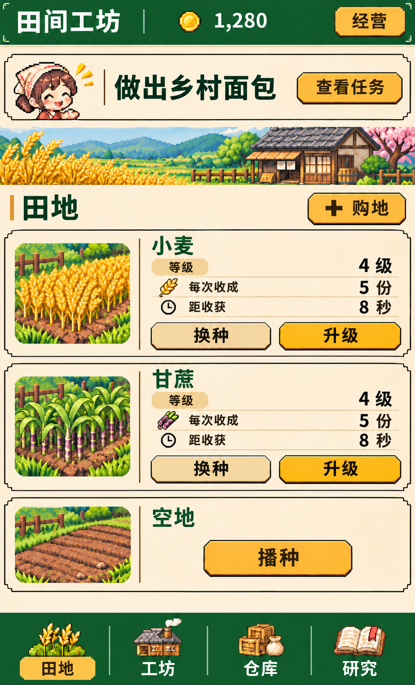
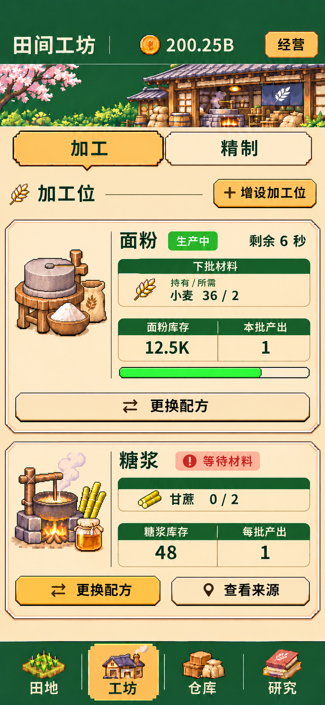
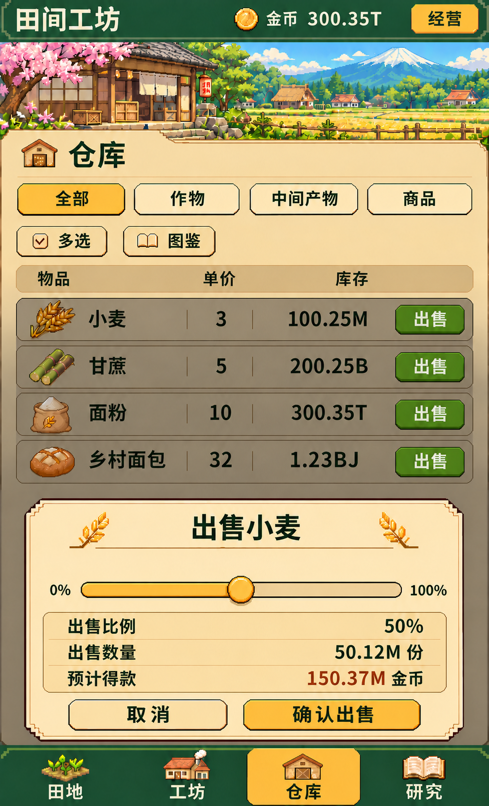
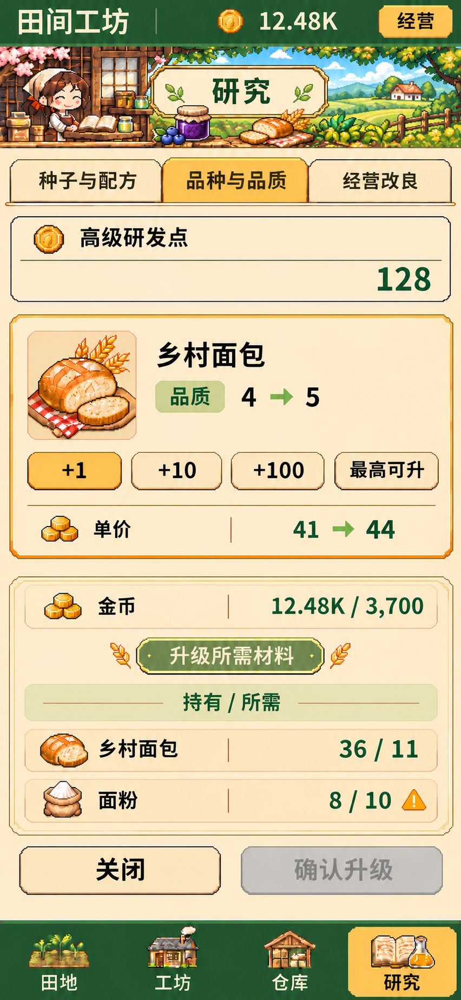
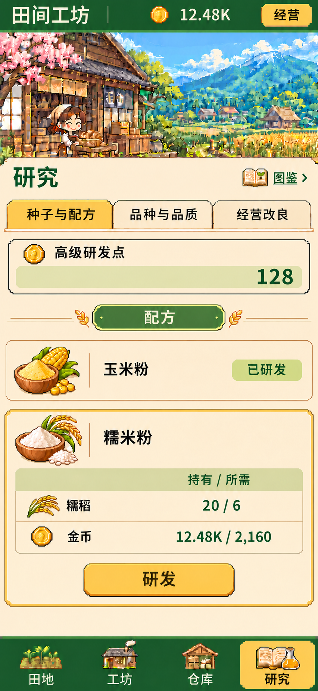
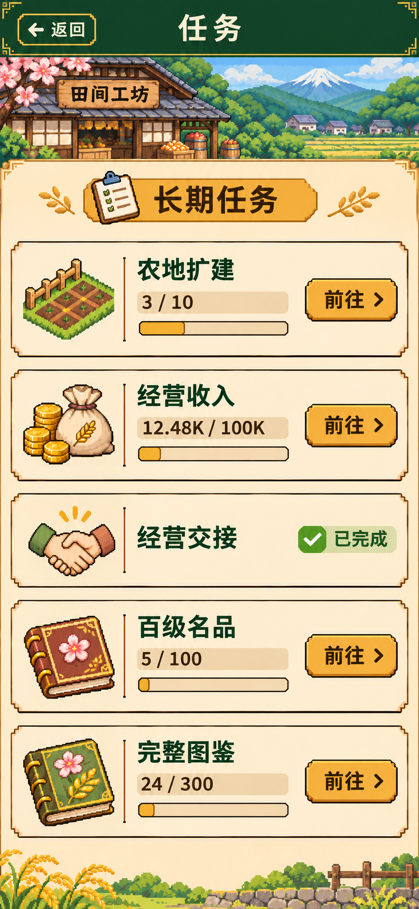
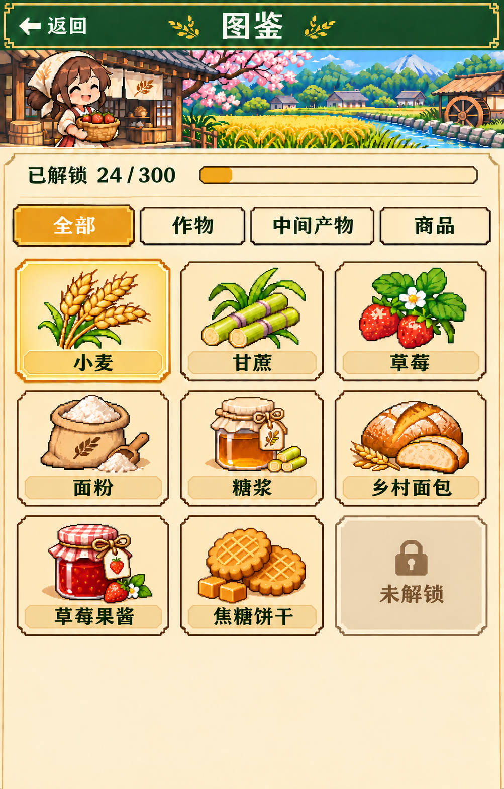
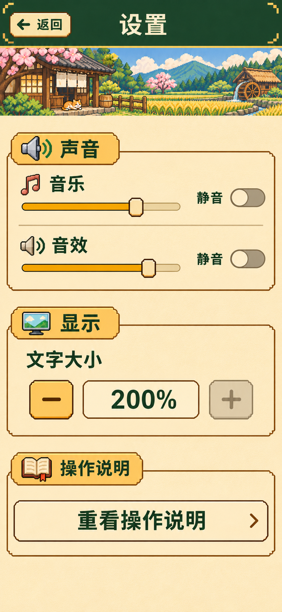
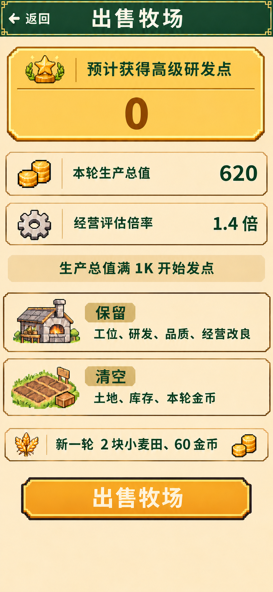

# 《放置农场》界面参考图

[查看科技树构图](research-tree/README.md) · [查看 v1.14 畜牧与水产界面](v1.14/README.md)

v1.10 共 8 个页面，研究页分别展示配方研发与品质提升。各图是独立示例。实际布局、按钮状态及文案以[逐页交互规格](../ui.md)为准。

图面使用日式乡野像素画、深松绿导航、暖米色面板与金色主要按钮。小屏或放大文字时，插画可收起，列表可滚动。

## 田地首页

当前任务、作物收成与距收获时间。四级田每次收成 5 份，已播种的田地自动续种。

## 工坊

面粉正在生产，显示本批产出与下批材料。糖浆等待甘蔗时，「更换配方」和「查看来源」均可用。

## 仓库

库存用字母后缀。出售滑条只显示一次选中比例，数量和预计得款各占一行。

## 研究 · 品质

品质、单价、金币和升级所需材料分区。面粉 8 / 10，确认升级禁用。高级研发点占独立一行。

## 研究 · 种子与配方

玉米粉已研发，糯米粉材料充足。点击「研发」后立即扣费并解锁。

## 任务

展示长期任务进度、「百级名品」以及已完成的经营交接。

## 图鉴

「已解锁 24 / 300」包含初始品项。点击条目可查看配方或来源。

## 设置

展示文字大小 200% 时的排版，增大文字按钮已达上限。

## 出售牧场

本轮生产总值为 620，预计获得 0 点，「出售牧场」可用。

